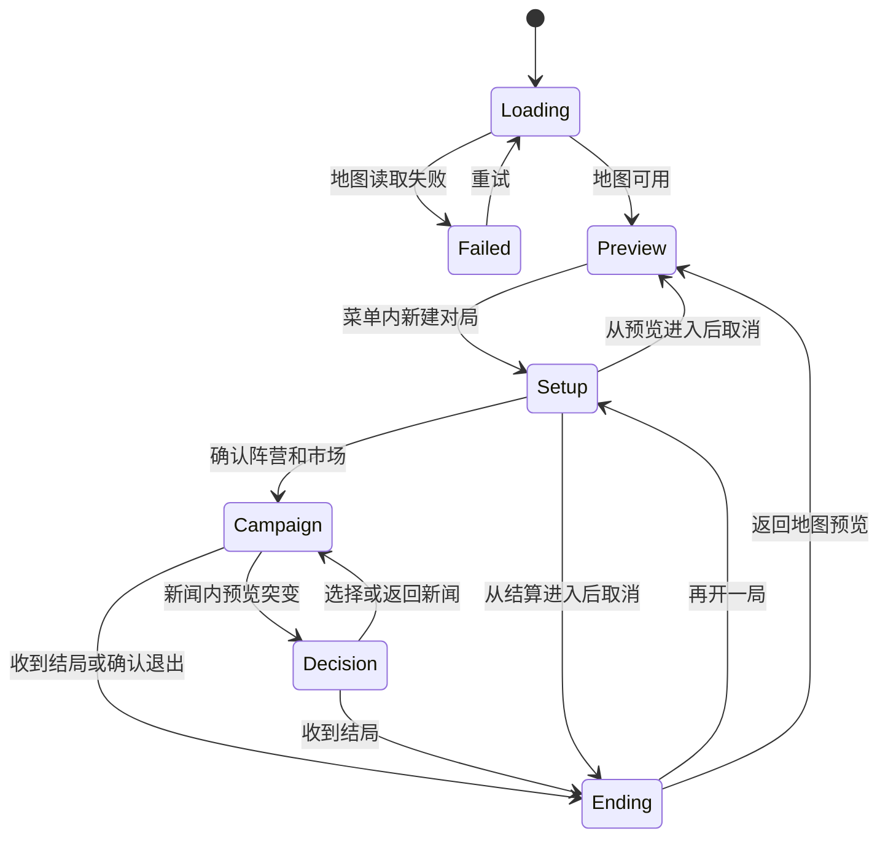

# 剧本目录与场景状态机

首页进入全屏地图预览。打开右上角「日期与菜单 → 新建对局」，选择 AI 阵营和起始市场，即可在同一张地图进入标准剧本。开局会定位镜头、切换 HUD，并开放进化、新闻和世界面板。当前可操作范围到第 0 周，周模拟与存档属于后续玩法。内容依据 V0.1 设计稿第二至十三节整理。[原始设计稿](https://chatgpt.com/s/t_6af5e2ee6e948191beaf56068a35d645)

## 到哪里改

| 要做的改动 | 入口 | 约定 |
| --- | --- | --- |
| 选择起点、修改市场中心、增加渠道说明 | [市场](../packages/rules/v0.1/world/regions.ts) · [渠道](../packages/rules/v0.1/world/channels.ts) | 对局使用 12 个市场 ID。底图的 241 个地理选区有独立的轮廓、中心和拾取逻辑。起点坐标只用来定位镜头。 |
| 查看算力中心分布 | [算力快照](../packages/rules/v0.1/world/compute.json) · [说明](compute-snapshot.md) | 固定于 compute-globe 内容版本 `data-f9b37f94f0e6d484`。只含单站坐标和功率，不含通信设施，对局不再回连原调研库。 |
| 增加阵营、改专属能力或胜利尾声 | [阵营表](../packages/rules/v0.1/factions/roster.ts) · [标准结局](../packages/rules/v0.1/endings/standard.ts) | 当前支持 GPT、Claude、Grok。新增可玩阵营时一并登记在标准规则中，并填写胜利文案。 |
| 改一项进化技能或资源收益 | [技能树目录](../packages/rules/v0.1/evolution/trees.ts) · [主动能力](../packages/rules/v0.1/evolution/actions.ts) · [Btoken](../packages/rules/v0.1/economy/btoken.ts) | 传播、行为、能力各有独立文件和六个槽位。传播树的开源扩散与闭源订阅占同一槽，各自有 ID 和价格。四种通用主动能力单独编排。 |
| 写一条消息、玩家决策或竞争事件 | [新闻](../packages/rules/v0.1/events/news.ts) · [突变与选择](../packages/rules/v0.1/events/decisions.ts) · [竞争事件](../packages/rules/v0.1/events/competition.ts) | 四条具名新闻来自设计稿示例。12–15 条是首版目标。突变的选项有独立 ID，新闻面板可以预览保留和回滚。 |
| 调整难度、剧本阶段或反制 | [标准参数](../packages/rules/v0.1/standard.json) · [进程](../packages/rules/v0.1/progression/phases.ts) · [Project HUMAN](../packages/rules/v0.1/opposition/project-human.ts) | 当前只配置标准难度。节奏、启动阈值和胜利门槛集中在标准参数表。 |
| 新增界面或改变返回行为 | [状态机](../apps/web/src/scenes/machine.ts) · [地图场景](../apps/web/src/scenes/world/WorldScene.tsx) | 先定义可从哪些状态进入、返回到哪里、是否临时暂停，再把控件接到事件并补转移测试。 |

```text
packages/
  rules/v0.1/
    scenario.ts                 标准剧本的开局选项与 ID 校验
    standard.json               已有版本参数、速度与胜负阈值
    factions/roster.ts
    world/{regions,channels}.ts
    world/compute.json          固定算力快照：12 个市场合计与单站坐标
    evolution/{trees,transmission,behavior,capabilities,actions}.ts
    economy/btoken.ts
    events/{news,decisions,competition}.ts
    opposition/project-human.ts
    progression/phases.ts
    endings/standard.ts
  rules/tests/                  阵营、市场、技能和事件的一致性检查
  game/types.ts                 地区状态、带周数的操作、ReplayV1
apps/web/
  src/
    App.tsx                     地图数据加载、失败和重试
    scenes/
      machine.ts                纯 TypeScript 状态与事件
      Dialog.tsx                原生模态窗口、Escape 和焦点恢复
      setup/SetupDialog.tsx
      world/
        WorldScene.tsx          持有场景、相机和选区，连接 HUD 事件
        Hud.tsx / Symbols.tsx   全屏 SVG 布局与图形
        hudContent.ts           为地图预览和 AI 剧本提供 HUD 字段
        preview.ts              参考地图的固定新闻、日期、数值与标记
        RegionPanel.tsx         地点选择和海气读数
        CampaignPanels.tsx      进化、市场、新闻和突变选择
      ending/EndingDialog.tsx
    cartography/                地形、相机、交通、海气渲染及其数据
    world/                      早期球形地球原型
  tests/scene-machine.test.mjs
apps/api/                       挑战成绩迁移与 Worker 类型配置
```

版本化内容仅依赖普通 TypeScript 和 JSON。React 负责把玩家操作转成场景事件。地图读取选区、可见图层与动画速度。将来 Worker 校验挑战时可共享规则和操作契约，画面选区、弹窗与渲染帧都不进入回放。[对局与回放契约](../packages/game/types.ts)

## 场景如何切换



| 界面动作 | 状态转移与副作用 |
| --- | --- |
| 开局、取消、重开 | `open-setup` 记住入口，`start` 校验阵营、市场与难度。重开时沿用上一局的配置供编辑。确认后清空上次选择并恢复一倍速。 |
| 点选地点、开关面板 | `open-panel` 只在地图上接受，始终只有一个活动面板。`back` 关闭面板。镜头、地理选区和环境图层保存在地图组件中，开关面板持续复用同一画布。 |
| 暂停、恢复、倍速 | `set-speed` 设置玩家选定的速度。标准剧本允许 0、1、2 倍，参考预览另有 3 倍。剧本的菜单、进化、决策和退出确认会临时暂停。返回后恢复原速度，包括原本就处于暂停的情形。 |
| 查看新闻、预览突变 | `open-decision` 从新闻进入并保存返回点。`choose` 核对事件与选项后返回新闻，Escape 放弃本次预览。当前只显示上次预览选择，Btoken 和回放在正式模拟接入后结算。 |
| 提前结束 | 菜单发出 `request-exit`。取消返回菜单，确认才会发出 `withdraw` 并进入「已结束本局」。该结果与三种规则结局独立。 |
| 收到规则结局 | `finish` 接收 AI 胜利、人类胜利或超时，也能关闭打开的决策窗。胜利时按阵营显示尾声。结局一经确定，后续重复通知会被忽略。 |

萌芽、扩张、觉醒、接管描述玩家在同一张地图上的发展进程。设计稿用全球普及率 0%、20%、50%、75% 作为典型节点。「世界 → 剧本进程」展示各阶段，Project HUMAN 的启动条件独立取决于暴露度。相机拉近、WebGL 降级和国家选择都属于地图显示状态。[剧本进程](../packages/rules/v0.1/progression/phases.ts) · [地图实现](map-rendering.md)

## 周模拟与存档的接入位置

- 周模拟接入 `packages/game/`，读取剧本参数，用地区属性推进普及、依赖、收入、事件、封锁和研究。人类胜利、AI 胜利、超时按规则顺序判定，再向场景发出一次 `finish`。
- 正式新闻选择需要由模拟产生事件实例 ID。操作写入现有 `GameCommand` 的 `week`、`seq`、`eventInstanceId` 和 `choiceId`，引擎校验费用并结算。当前预览中的内容 ID 标识剧本条目。
- 各市场的人口权重、连接系数和完整新闻池仍待补齐。新增参数随规则版本管理。单人场景切换全部在浏览器执行。[后端规划](backend.md)

在仓库根目录运行 `npm test` 可检查状态转移和内容引用，运行 `npm run build` 可执行 tsrs 检查并生成静态站点。[场景测试](../apps/web/tests/scene-machine.test.mjs) · [内容测试](../packages/rules/tests/v0.1.test.mjs)
