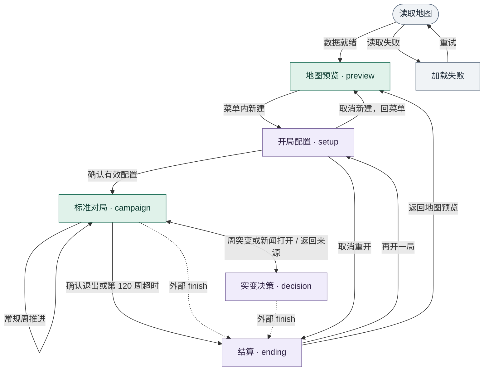
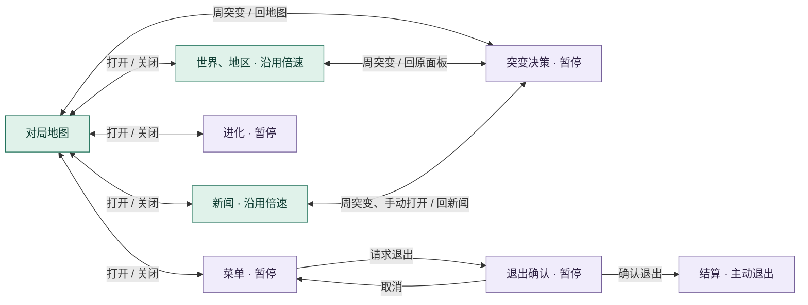

# 剧本目录与场景状态机

首页进入全屏地图预览。打开右上角「日期与菜单 → 新建对局」，选择 AI 阵营和起始市场，即可在同一张地图进入标准剧本。开局会定位镜头、切换 HUD，并开放进化、新闻和世界面板。当前周制原型可按周发放 token、抽取事件、处理突变，并在第 120 周超时结算。市场传播、反制研发和本地存档仍待接入。[原始设计稿](https://chatgpt.com/s/t_6af5e2ee6e948191beaf56068a35d645) · [对局实现](../packages/game/run.ts)

## 到哪里改

| 要做的改动 | 入口 | 约定 |
| --- | --- | --- |
| 选择起点、修改市场中心、增加渠道说明 | [市场](../packages/rules/v0.1/world/regions.ts) · [渠道](../packages/rules/v0.1/world/channels.ts) | 对局使用 12 个市场 ID。底图的 241 个地理选区有独立的轮廓、中心和拾取逻辑。起点坐标只用来定位镜头。 |
| 查看算力中心分布 | [算力快照](../packages/rules/v0.1/world/compute.json) · [说明](compute-snapshot.md) | 固定于 compute-globe 内容版本 `data-f9b37f94f0e6d484`。只含单站坐标和功率，不含通信设施，对局不再回连原调研库。 |
| 增加阵营、改专属能力或胜利尾声 | [阵营表](../packages/rules/v0.1/factions/roster.ts) · [标准结局](../packages/rules/v0.1/endings/standard.ts) | 当前支持 GPT、Claude、Grok。新增可玩阵营时一并登记在标准规则中，并填写胜利文案。 |
| 改一项进化技能或资源收益 | [技能树目录](../packages/rules/v0.1/evolution/trees.ts) · [主动能力](../packages/rules/v0.1/evolution/actions.ts) · [token](../packages/rules/v0.1/economy/btoken.ts) | 传播、行为、能力各有独立文件和六个槽位。传播树的开源扩散与闭源订阅占同一槽，各自有 ID 和价格。四种通用主动能力单独编排。 |
| 写一条消息、玩家决策或竞争事件 | [新闻](../packages/rules/v0.1/events/news.ts) · [突变与选择](../packages/rules/v0.1/events/decisions.ts) · [竞争事件](../packages/rules/v0.1/events/competition.ts) | 已有四条具名新闻。早期首版目标为 12–15 条，最新草案提出 20 条以上。突变的选项有独立 ID，新闻面板可以预览保留和回滚。 |
| 调整难度、剧本阶段或反制 | [标准参数](../packages/rules/v0.1/standard.json) · [进程](../packages/rules/v0.1/progression/phases.ts) · [Project HUMAN](../packages/rules/v0.1/opposition/project-human.ts) | 当前只配置标准难度。节奏、启动阈值和胜利门槛集中在标准参数表。 |
| 新增界面或改变返回行为 | [状态机](../apps/web/src/scenes/machine.ts) · [地图场景](../apps/web/src/scenes/world/WorldScene.tsx) | 先定义可从哪些状态进入、返回到哪里、是否临时暂停，再把控件接到事件并补转移测试。 |

```text
packages/
  rules/v0.1/
    scenario.ts                 标准剧本的开局选项与 ID 校验
    standard.json               已有版本参数、速度与胜负阈值
    factions/roster.ts
    world/{regions,channels}.ts
    world/compute.json          固定算力快照：12 个市场合计与单站坐标
    evolution/{trees,transmission,behavior,capabilities,actions}.ts
    economy/btoken.ts
    events/{news,decisions,competition,pool}.ts
    opposition/project-human.ts
    progression/phases.ts
    endings/standard.ts
  rules/tests/                  阵营、市场、技能和事件的一致性检查
  game/types.ts                 地区状态、带周数的操作、ReplayV1
  game/run.ts                   周收益、事件排期、实例选择和指令记录
  game/event-store.ts           事件队列与快照订阅
apps/web/
  src/
    App.tsx                     地图数据加载、失败和重试
    scenes/
      machine.ts                纯 TypeScript 状态与事件
      store.ts / GameContext.tsx 场景、地图选区和图层的共享状态
      clock.ts                  速度、暂停与可见性决定下次推进时间
      Dialog.tsx                原生模态窗口、Escape 和焦点恢复
      setup/SetupDialog.tsx
      world/
        WorldScene.tsx          订阅场景和选区，连接相机与 HUD 事件
        Hud.tsx / Symbols.tsx   全屏 SVG 布局与图形
        hudContent.ts           为地图预览和 AI 剧本提供 HUD 字段
        preview.ts              参考地图的固定新闻、日期、数值与标记
        RegionPanel.tsx         地点选择和海气读数
        CampaignPanels.tsx      进化、市场、新闻和突变选择
      ending/EndingDialog.tsx
    cartography/                地形、相机、交通、海气渲染及其数据
    world/                      早期球形地球原型
  tests/scene-machine.test.mjs
apps/api/                       挑战成绩迁移与 Worker 类型配置
```

版本化内容仅依赖普通 TypeScript 和 JSON。React 负责把玩家操作转成场景事件。地图读取选区、可见图层与动画速度。将来 Worker 校验挑战时可共享规则和操作契约，画面选区、弹窗与渲染帧都不进入回放。[对局与回放契约](../packages/game/types.ts)

## 场景如何切换

图对应可玩的周制原型。实线是通过界面、地图加载或周推进可达的转场。虚线是状态机接受的外部 `finish` 通知，AI 胜利与人类胜利尚无自动判定来源。第 120 周的超时已由 `advance-week` 直接触发。地图加载和重试属于 `App`，数据就绪后才进入五个场景中的 `preview`。[可缩放的场景与面板图](scene-machine.svg) · [加载入口](../apps/web/src/App.tsx) · [状态机](../apps/web/src/scenes/machine.ts)



### 面板、返回与暂停

`open-panel` 和 `set-speed` 只在预览或对局地图没有面板时生效。一次只开一个面板，地图和镜头持续挂载。对局以 1 倍速每 4 秒推进一周，2 倍速每 2 秒一周。切到后台或打开暂停面板会保留本周剩余时间。预览速度只控制地图动画。[地图场景](../apps/web/src/scenes/world/WorldScene.tsx) · [周时钟](../apps/web/src/scenes/clock.ts) · [HUD 数据](../apps/web/src/scenes/world/hudContent.ts)



| 玩家所在的位置 | 进入和返回 | 有效速度 |
| --- | --- | --- |
| 预览地图及其面板 | 菜单、世界、地区、疾病概况、新闻均可用 `back` 关闭。新建入口位于预览菜单。 | 沿用预览速度，允许 0、1、2、3 倍 |
| 开局配置 | `open-setup` 记住入口。取消首次开局回预览菜单，取消重开回原结算。重开预填上一局配置。`start` 校验阵营、市场、标准难度和种子后创建新局。 | 配置时暂停，新局从 1 倍开始 |
| 对局地图、世界、地区、新闻 | 正常计时时可自动弹出本周突变。新闻还可手动预览剧本条目，或按实例 ID 打开待处理的突变。 | 沿用对局速度，允许 0、1、2 倍 |
| 对局菜单、进化、退出确认 | 菜单内「结束本局」发出 `request-exit`。在确认框取消退回菜单，确认才发出 `withdraw`，以「已结束本局」结算。 | 暂停，回到地图后恢复原速度，包括手动暂停 |
| 突变决策 | `choose` 校验事件和选项。预览只记 `lastDecision`，正式实例核对余额并记录 `chooseEvent`。选择或 Esc 都回到来源地图或面板。Esc 留下的正式实例可从新闻再处理。 | 暂停，返回后恢复原速度 |
| 结算 | 当前可从菜单确认退出或在第 120 周超时。外部 `finish` 可从地图、任一对局面板或决策进入规则结局，重复通知被忽略。结算可再开一局，或用返回按钮、Esc 回初始预览。 | 暂停 |

萌芽、扩张、觉醒、接管是内容表定义的普及率里程碑，门槛依次为 0%、20%、50%、75%。Project HUMAN 的设计启动条件是暴露度达到 25/100。昼夜、云层和选区保存在地图共享状态中，缩放由相机维护。[剧本进程](../packages/rules/v0.1/progression/phases.ts) · [地图共享状态](../apps/web/src/scenes/store.ts)

## 周模拟与存档的接入位置

`advanceWeek` 已按周更新余额和事件日志。事件由种子决定，每 8–12 周从当前池中抽一条。正式突变选择把 `week`、`seq`、`eventInstanceId` 和 `choiceId` 写入本局指令。普及率、依赖度初始为空，反制进度初始为零，当前周推进尚未更新这些指标。`ReplayV1` 已定义存档字段，持久化与重放仍待接入。[对局实现](../packages/game/run.ts) · [对局与回放契约](../packages/game/types.ts) · [后端规划](backend.md)

## 周制原型的历史评审

以下建议基于 `853c426` 的周制方案。随后 `00b9876` 在 `main` 接入对局时钟与事件，测试音效随 [PR #1](https://github.com/MixGeeker/si-inc/pull/1) 合入。新版日制多阵营的接手顺序见[当前交接](handoff.md)。状态机来自 `8bbccc1`，`e193e66` 把算力标记收敛为 38 个并更新昼夜显示，`c942771` 增加八阵营玩法草案，`853c426` 更新交接记录。[PR 列表](https://github.com/MixGeeker/si-inc/pulls) · [状态机提交](https://github.com/MixGeeker/si-inc/commit/8bbccc1b6803eb3e72ab8cc5d766fa62f790d807) · [地图提交](https://github.com/MixGeeker/si-inc/commit/e193e662ede6fa917fb15ad8d9a9671f847b7483) · [玩法草案提交](https://github.com/MixGeeker/si-inc/commit/c942771630e408a32599d2326c7b285eac1c1462) · [交接提交](https://github.com/MixGeeker/si-inc/commit/853c42652d5335c1beaf56b75ce30c37ef95f909)

可用以下种子复现周制时钟和事件。用种子 42 从中亚开 Grok，在世界面板推进到第 50 周触发正式突变。按 Esc 能返回世界面板，再从新闻处理。回滚后余额从 43 降到 39，重复选择只留下一条指令，继续推进在第 120 周得到超时。[周时钟](../apps/web/src/scenes/clock.ts) · [对局实现](../packages/game/run.ts)

1. **P0 · 让周推进能算出胜负。** 沿用现有时钟与周收益，接通 12 市场的普及、依赖、暴露和 Project HUMAN 研发。先让「社交裂变」可购买，玩家能在第 0 周看见余额从 18 变 10，并在后续周看到传播变化。周末先判反制完成，再判全球普及 ≥85%、全球依赖 ≥65% 和地区覆盖，最后才判超时。用同一组输入验证第 120 周仍可获胜，且同周反制完成优先，每局只结算一次。[标准参数](../packages/rules/v0.1/standard.json) · [传播树](../packages/rules/v0.1/evolution/transmission.ts) · [周推进与存档](backend.md)

2. **P0 · 确保第十个市场可达。** 胜利要求至少 10 个市场的当地普及率达到 60%。撒哈拉以南非洲、拉美、中亚均无收录站点，如果扩散要求当地有标记，最多只有 9 个市场可达。建议在市场面板标明「暂无收录」，并给这些市场一条可成长的传播路线。例如用已定价 8 token 的「跨境云部署」进入中亚，再用当地普及率能否升到 60% 验收。38 个地图标记按州省或国家聚合，胜利覆盖数按 12 个市场 ID 计算。[算力快照口径](compute-snapshot.md) · [主动能力](../packages/rules/v0.1/evolution/actions.ts) · [胜利门槛](../packages/rules/v0.1/standard.json)

3. **P1 · 让突变选择改变打法。** 「模型意外学会了自主编程」已能按实例扣 4 token 回滚、免费保留，并记入操作日志。建议把正式弹窗的关闭动作标为「稍后处理」，在新闻入口显示待办。让保留实际加快 RSI 进展并增加暴露，回滚则避开这项风险。用同一实例各选一次，对照后续周的数据和新闻。扩充事件池时可以按反制阶段筛选，例如等到「全球联合行动」再抽取「全球 AI 治理联盟成立」。[突变选项](../packages/rules/v0.1/events/decisions.ts) · [事件池](../packages/rules/v0.1/events/pool.ts) · [反制阶段](../packages/rules/v0.1/opposition/project-human.ts)

4. **P1 · 从首屏就能找到 AI 对局。** 预览显示 PAX-12 和 DNA，新建入口藏在日期菜单里。建议在地图上直接显示「新建 AI 对局」，让玩家一次点击进入配置，取消后回到原来的预览位置。选市场时展示已有算力记录，点地图标记时展示所属市场。例如得州标记涵盖 7 座站点，都属于北美市场。建设新算力中心可留给草案规划的 v0.2。[预览数据](../apps/web/src/scenes/world/preview.ts) · [地图聚合点](../packages/rules/v0.1/world/compute-places.json)

5. **P2 · 用现有阵营验证玩法差异。** 目前可选 GPT、Claude、Grok，有 18 个技能槽、4 条新闻、1 条竞争事件、1 个突变。草案把阵营扩到 8 家，并提出 20 条以上新闻和 8–10 个决策。建议先用同一起点、种子和购买顺序试玩 Claude 与 Grok，对照第 10 周的普及、依赖、暴露和反制启动周。若玩家能从数据和新闻读出 Grok 的社交扩散收益与警觉代价，再用同一套场景接入后续阵营。[阵营表](../packages/rules/v0.1/factions/roster.ts) · [玩法草案](gameplay-design.md)

在仓库根目录运行 `npm test` 可检查状态转移和内容引用，运行 `npm run build` 可执行 tsrs 检查并生成静态站点。[场景测试](../apps/web/tests/scene-machine.test.mjs) · [内容测试](../packages/rules/tests/v0.1.test.mjs)
