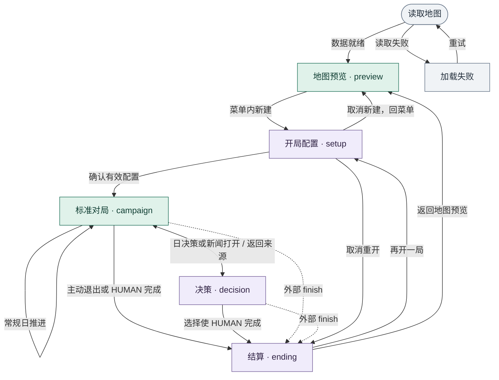

# 剧本目录与场景状态机

首页进入全屏地图预览。打开右上角「日期与菜单 → 新建对局」，选择 AI 阵营和起始市场，即可在同一张地图进入标准剧本。当前对局按天发放 token 和研究语料、推进研究、抽取事件并处理决策。常速每 4 秒一天，支持 1、2、5 倍速和独立暂停，没有固定到期日。危险研究或事件选择使 Project HUMAN 达到 100% 时进入人类胜利；玩家也可主动退出。市场传播、多阵营经营、完整局势胜负和本地存档仍待接入。[运行规范](game-runtime.md) · [对局实现](../packages/game/run.ts)

## 到哪里改

| 要做的改动 | 入口 | 约定 |
| --- | --- | --- |
| 选择起点、调整地区归属、增加渠道说明 | [大洲、地理选区和槽位](../packages/rules/v0.1/world/regions.ts) · [渠道](../packages/rules/v0.1/world/channels.ts) | 对局从六个大洲中选择起点。点地图和选目录使用相同的大洲 ID。 |
| 查看算力中心分布 | [算力快照](../packages/rules/v0.1/world/compute.json) · [说明](compute-snapshot.md) | 只含单站坐标和功率，不含通信设施，对局不再回连原调研库。 |
| 增加阵营、改专属能力或胜利尾声 | [阵营表](../packages/rules/v0.1/factions/roster.ts) · [标准结局](../packages/rules/v0.1/endings/standard.ts) | 当前支持 GPT、Claude、Grok。新增可玩阵营时一并登记在标准规则中，并填写胜利文案。 |
| 改一项进化技能或资源收益 | [技能树目录](../packages/rules/v0.1/evolution/trees.ts) · [流派](../packages/rules/v0.1/evolution/builds.ts) · [主动能力](../packages/rules/v0.1/evolution/actions.ts) · [token](../packages/rules/v0.1/economy/btoken.ts) | 传播 17 项、行为 17 项、能力 16 项，共用七个研究槽。价格、工期和周期效果使用日制规则。 |
| 写新闻、决策或竞争事件 | [新闻](../packages/rules/v0.1/events/news.ts) · [决策与选择](../packages/rules/v0.1/events/decisions.ts) · [竞争事件](../packages/rules/v0.1/events/competition.ts) | 内容有稳定 ID，正式实例另有包含对局身份的实例 ID。选择按实例结算一次，后续报道从实际选择日排期。 |
| 调整时间、难度、剧本阶段或反制 | [标准参数](../packages/rules/v0.1/standard.json) · [进程](../packages/rules/v0.1/progression/phases.ts) · [Project HUMAN](../packages/rules/v0.1/opposition/project-human.ts) | 常速 4 秒/日，1、2、5 倍速，没有最大对局日数。结束由有效退出或局势规则触发。 |
| 新增界面或改变返回行为 | [状态机](../apps/web/src/scenes/machine.ts) · [共享状态](../apps/web/src/scenes/store.ts) | 先定义进入、返回及暂停行为，再接控件和测试。手动暂停与选择倍速分别保存。 |

```text
packages/
  rules/v0.1/
    scenario.ts                 标准剧本的开局选项与 ID 校验
    standard.json               日制时间参数、速度与局势阈值
    factions/roster.ts
    world/{regions,channels}.ts
    world/compute.json          固定算力快照
    evolution/{trees,transmission,behavior,capabilities,actions}.ts
    economy/btoken.ts
    events/{news,decisions,competition,pool}.ts
    opposition/project-human.ts
    progression/phases.ts
    endings/standard.ts
  rules/tests/                  内容一致性检查
  game/types.ts                 day + seq 指令与 ReplayV2
  game/run.ts                   日收益、研究、事件、选择和指令记录
  game/inspection.ts            回放导出与确定性时间线检查
  game/event-store.ts           事件队列与快照订阅
apps/web/
  src/
    App.tsx                     地图数据加载、失败和重试
    scenes/
      machine.ts                场景、倍速和手动暂停事件
      store.ts / GameContext.tsx 每根应用的 store、暂停原因和时钟所有者
      clock.ts                  日内进度、环境输入和逐日推进
      Dialog.tsx                原生模态窗口、Escape 和焦点恢复
      setup/SetupDialog.tsx
      world/
        WorldScene.tsx          连接地图、相机与 HUD 事件
        Hud.tsx / Symbols.tsx   全屏 SVG 控件与图形
        hudContent.ts           读取对局或预览的 HUD 字段
        preview.ts              固定预览数据
        RegionPanel.tsx         地点选择和海气读数
        CampaignPanels.tsx      市场和决策面板
        ResearchDialog.tsx      研究槽与科技树
        DeveloperPanel.tsx     单步、试跑和时间线
      ending/EndingDialog.tsx
    cartography/                地形、相机、交通、海气渲染与数据
    world/                      早期球形地球原型
  tests/                        场景、时钟、store 与界面数据测试
apps/api/                       尚未接入的挑战接口规划与初始 D1 DDL
```

版本化内容只依赖普通 TypeScript 和 JSON。React 将玩家操作转为有类型的事件，浏览器时钟只发送 `{ type: "advance-day", runId, completedDay }`。纯函数核对对局身份与日界线，提交新快照后再通知订阅者。未来 Worker 可复用同一引擎；地图选区、弹窗、倍速、暂停时长和渲染帧都不进入业务回放。[运行规范](game-runtime.md) · [对局与回放契约](../packages/game/types.ts)

## 场景如何切换

实线表示当前界面或共享规则可达的转场。HUMAN 完成已能通过每日危险研究结题或正式事件选择触发；AI 胜利的完整自动判定尚待经营规则接入。虚线 `finish` 是已有的外部规则结局入口。地图加载和重试属于 `App`，数据就绪后进入 `preview`。[可缩放的场景与面板图](scene-machine.svg) · [加载入口](../apps/web/src/App.tsx) · [状态机](../apps/web/src/scenes/machine.ts)



### 面板、返回与暂停

`open-panel` 只在预览或对局地图没有其他面板时打开新面板。`set-speed` 设置 1、2、5 倍速，`set-paused` 独立设置手动暂停；暂停期间修改倍速不会恢复运行。常速每 4 秒一天，2 倍速每 2 秒一天，5 倍速每 0.8 秒一天。菜单、研究、决策、退出确认、开发者面板和页面环境可分别造成暂停；只有全部原因解除才恢复。预览速度只控制地图动画。[地图场景](../apps/web/src/scenes/world/WorldScene.tsx) · [日时钟](../apps/web/src/scenes/clock.ts) · [暂停判定](../apps/web/src/scenes/store.ts)


| 玩家所在的位置 | 进入和返回 | 有效速度 |
| --- | --- | --- |
| 预览地图及其面板 | 面板可用 `back` 关闭，新建入口位于预览菜单。 | 可选 1、2、5 倍速；手动暂停、菜单、概况和环境暂停分别生效。 |
| 开局配置 | 取消首次开局回预览菜单，取消重开回原结算。`start` 校验配置、生成独立 `runId` 并创建新局。 | 配置时暂停；新局从 1 倍、未手动暂停开始。 |
| 对局地图、世界、地区、新闻 | 日推进可打开本日决策，也可从新闻打开预览或待处理实例。 | 沿用所选倍速，仍受手动和环境暂停约束。 |
| 对局菜单、研究、退出确认 | 确认退出才发出 `withdraw`。关闭面板后恢复到来源。 | 暂停；关闭只解除该面板原因，手动暂停继续保留。 |
| 决策 | 选择或 Esc 返回来源；Esc 留下正式实例，新闻待办可再次打开。 | 暂停；返回后仍检查其他暂停原因。 |
| 结算 | HUMAN 完成、有效退出或外部规则结局进入；可重开或返回预览。 | 暂停，没有日期到期入口。 |

页面隐藏和冻结保留本日进度，恢复后不补后台天数。一个应用根持有同一 `createDayClock`，停用后重挂保留其日内进度；新局清零。前台迟到最多逐日追赶三天，每天提交后立即检查决策、暂停和终局。完整的页面存读档尚未接入。[时钟行为](game-runtime.md#日界线倍速与暂停)

## 日模拟与回放边界

`completedDay = N` 表示已经完成第 N 天，当前行动属于下一次日结算前的窗口。每个经营指令记录 `{ day: N, seq }`。`advanceDay` 使用旧快照的有效科技结算本日 token 和语料，再处理本日研究完成及危险值；HUMAN 达到 100% 则结束，否则投递本日后续和新事件。新完成的增产科技从次日起供数。[日结算](../packages/game/run.ts) · [研究](../packages/game/research.ts)

事件由种子决定，每 8–12 天抽取候选。正式选择按实例 ID 记录费用、资源效果、反制和实际选择日；后续报道从实际选择日继续排期。相同种子和经营指令应产生相同业务结果，运行期的 `runId` 用来隔离异步输入，不改变业务随机序列。开发者面板通过 `nextEventDay` 统一读取随机事件、后续报道和研究里程碑的最近日期，「到下个事件」仍逐日提交，不直接跳过中间日结算。

普通对局导出 `ReplayV2`（`saveVersion: 2`），包含 `runId`、规则版本、种子、开局配置、已完成日数和指令。含开发者发放的对局导出独立的 `debug-replay`、`version: 2`。`runTimeline` 已能从当前快照重演并检查经营、研究和叙事轨迹；从回放文件导入续玩、IndexedDB 持久化和服务端验分尚未接入。本项目不保留周制回放兼容或迁移层。[导出与时间线](../packages/game/inspection.ts) · [回放类型](../packages/game/types.ts) · [后端规划](backend.md)

## 当前验收清单

1. **日制推进。** 以 4 秒/日的常速推进，2 倍和 5 倍分别为 2 秒和 0.8 秒；余额、研究和事件只在有效日结算提交一次。
2. **无固定到期。** 在没有局势终局的条件下跨过第 120 天继续运行，收入和事件继续；HUMAN 完成或主动退出后不再推进。
3. **暂停叠加。** 手动暂停与菜单、研究、决策、后台交叠；解除其中一项不能提前恢复。变速和恢复保留当前日进度。
4. **新局隔离。** 同种子重开产生新的 `runId`；上一局的回调、重复日推进和过期研究指令均被拒绝。
5. **确定性与决策断点。** 同种子、同日同序号指令在不同倍速下产生相同结果；迟到追赶遇到决策或终局立即停止。
6. **事件与研究。** 研究在到期日释放槽位、次日享受增产；延后选择的事件按实际选择日投递后续，重复选择不再扣款。

在仓库根目录运行 `npm test` 检查受影响的正常路径和拒绝路径，运行 `npm run build` 完成类型检查与静态构建。地图各市场可达性、多阵营经济和完整胜负的验收随对应玩法实现补充。[测试目录](../apps/web/tests/) · [玩法草案](gameplay-design.md)
