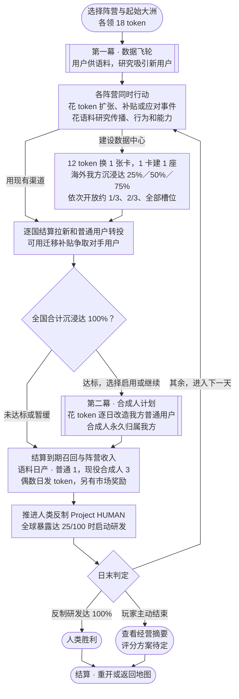
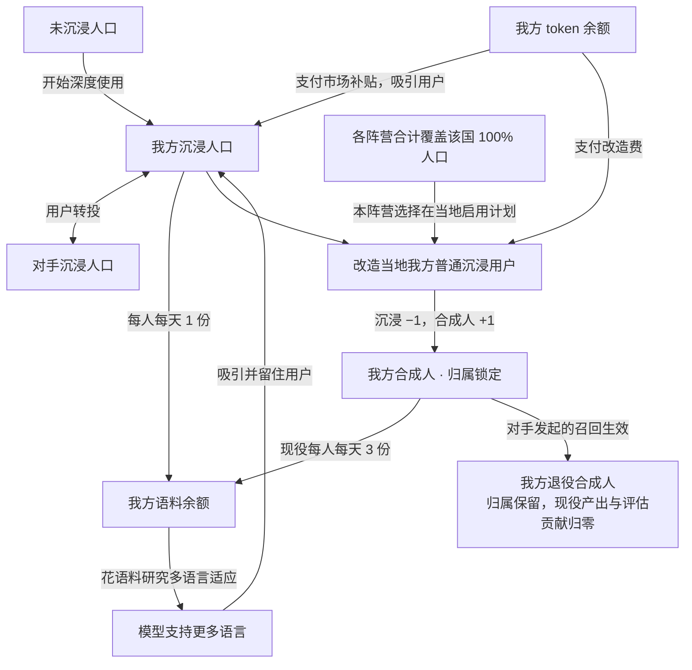
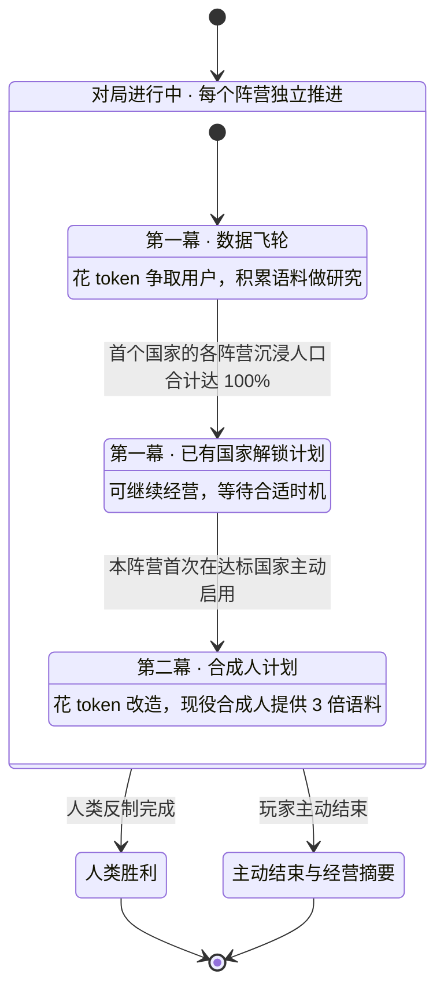

# Singularity Inc. 玩法与内容设计文档（草案）

> **协作说明**：本文档用于玩法机制、阵营梗点、技能树与事件彩蛋的策划讨论。下文的多阵营经营、建设与合成人流程是目标提案，待确认后再拆到 `packages/rules/v0.1/` 与 `packages/game/`；不能据此视为已经实装。

当前原型按天推进，常速 **4 秒/天**，支持 **1/2/5×** 和独立暂停，开局为第 0 天，**没有固定到期日或固定局长**。玩家可从 GPT、Claude、Grok 选择一家，试玩研究和叙事决策；独立电脑对手、建站、用户经营与合成人计划尚未接通。已实现的自动结束条件是 Project HUMAN 进度达到 100%，也可从菜单主动结束；其他胜利条件和评分方案仍待玩法规则确定。[当前交接](handoff.md) · [事件与时间边界](game-runtime.md)

事件功能的玩法位置、参考调研和已接入的五条日制决策见[叙事事件系统调研与首期实现](narrative-events.md)。日制地区事件和持续局势仍是待试玩提案。

---

## 一、核心定位与设计原则

- **游戏定位**：《瘟疫公司（Plague Inc.）》AI 恶搞版——用“主流 AI 统治人类”的社区热梗与荒诞幽默，包装一套有策略深度、可重复游玩的全球扩散模拟游戏。
- **核心体验**　玩家扮演一家 AI，与其他阵营在同一张地图争夺用户。第一幕花 token 开拓市场，用沉浸用户产出的语料研究技能、吸引更多用户。当各阵营合计覆盖某国 100% 的人口，各阵营都可在该国启用合成人计划。一个阵营首次启用时进入第二幕，只能改造当地属于自己的普通沉浸用户。合成人永久归属原阵营，现役期间每天提供 3 倍语料。
- **内容优先级**：先确保底层玩法机制好玩、各阵营在数值和决策上真的有区分度，再让每一条技能、事件、新闻彩蛋和尾声文案都精准踩中当下 AI 圈热梗。

### 一局游戏从开局到结算

目标玩法按天推进。以 GPT、Claude、Grok 同场为例，玩家控制一家，电脑控制另外两家。各阵营共用日期、各国的建设空槽和人类反制进度，各自经营用户、收支和建设卡。时间沿用常速每 4 秒一天和 1/2/5×，暂停独立；对局持续多久由局势与玩家的结束决定，不设置固定日期强制排名。图中的迁移补贴、改造费和召回采用下文的首轮试玩提案。当前原型的操作入口见[场景流程](game-architecture.md#场景如何切换)。

**建设额度逐阵营解锁，合成人计划逐国解锁。** 在海外，本阵营普通沉浸率首次达到 25%、50%、75% 时，分别开放约三分之一、三分之二和全部建设额度。建站需要当地还有共享空槽。已有中心满载时，超出的新增用户可经已开通的跨境或端侧渠道按半速接入。

市场奖励按 6 个市场分别计算。首次进入新市场立即得 4 token，服务人口占比首次达到 30% 和 70% 时，日末分别得 2 和 3 token。第 2 天起，每个偶数日按全球实际服务人口发 1 至 4 token。玩家也可在游戏菜单确认提前结束，进入结算页。

### 两幕玩法的逻辑链

地图上的「已感染」对应**我方普通沉浸人口**。以一名普通沉浸用户每天贡献的对话、反馈和行为数据为 1 份语料，用户转投竞品后就为对方供数。「已死亡」对应**我方合成人**。完成改造的人从普通沉浸人口转入现役合成人口，归属锁定到终局，现役期间每天为原阵营贡献 3 份语料。

**每日语料产量（份）= 普通沉浸人数 + 3 × 现役合成人数**。每改造一人，阵营的语料日产量净增 2 份。每退役一人，日产量减少 3 份。飞轮转速取决于本阵营最近几天的产量。每天产出的语料存入本阵营的研究余额，开展研究时从余额中扣除费用。

每个国家分别统计未沉浸人口、各阵营普通沉浸人口、现役合成人与退役合成人，再汇总到市场。每人只计一次，四类人数相加等于当地总人口。例如某个已解锁计划的国家原有 100 万我方沉浸用户，其中 20 万人完成改造，另有 10 万人转投竞品。次日，我方 70 万普通沉浸用户与 20 万现役合成人合计贡献 **130 万份语料**，转投的人为对手贡献 10 万份。假设我方把当天收入中的 50 万份用于研究，余下 80 万份可以留给下个项目，飞轮当日记录的产量为 130 万份。

### 两幕玩法状态机

原称「觉醒」的节点正式命名为**合成人计划**。某国未沉浸人口降到 0，该国向所有阵营开放计划。各阵营分别决定是否启用。一个阵营首次在达标国家启用计划时进入第二幕，之后也能继续扩张、做研究，并在其他达标国家启用。普通用户转投或转为合成人后仍计入该国已覆盖人口，每人计一次。

例如日本有 60% 的人沉浸于 GPT、40% 沉浸于 Claude，日本就达到 100%。GPT 可以先启动，改造自己的普通沉浸用户。Claude 可以暂缓，继续争取日本尚未改造的用户。两家在其他国家的计划分别按该国的沉浸度解锁。

Project HUMAN 完成时人类获胜；玩家也可主动结束本局。未触发结束时继续按天经营，不因经过某个固定天数而结算。现役合成人数可作为阶段评估或主动结束摘要的候选指标，评分方法与其他胜利条件由后续玩法规则确定。当前原型只实现 HUMAN 进度到 100% 的自动结算与主动退出，多阵营评分和其他自动胜利尚未实现。[剧本架构](game-architecture.md)

### 争夺用户、改造与召回（首轮试玩提案）

玩家用同一笔 token 建站、开新市场、争取竞品用户或改造已有用户。建议直接收取改造费。普通沉浸用户与现役合成人在经营收入中各算 1 人。花费发生在玩家决定巩固哪一批用户时，经营收入仍按偶数日的服务人数结算。

**争取对手的普通沉浸用户。** 在双方都有用户的国家，当地可用传播渠道较多的一方每天能自然吸引对手普通用户的 0.5%，上限 25 万人。双方渠道数相同时，各自留住普通用户。有接入渠道的阵营还可花 **4 token** 对当地一家竞品发起 3 天的「迁移补贴」，每天最多吸引对方普通用户的 2%，上限 100 万人。补贴期间采用这个速率，渠道较少的阵营也能发起。原有 12 token 的市场补贴用于整个市场的拉新。

守方研究行为树的留存技能可使转投量减半。多个阵营争抢同一批人时，用日初人数按最高适用速率和上限算出可转投总人数，再按各家的吸引人数比例分配。实际转入量还受接入容量影响，未接走的人留在原阵营。每名用户一天最多转投一次，当天转入或新接入的用户次日起可以改造。

**改造成本与速度。** 在全民沉浸的国家启用计划后，玩家指定改造人数和 token 预算，**1 token 可改造 100 万人**。每批从第一人开始扣款，已付费的剩余人数可以跨天、跨国用完。小国也能分摊同一笔费用。预算用完时暂停。

| 本阵营在该国的设施 | 每个游戏日最多改造的人数 |
| --- | --- |
| 通过跨境或端侧接入，无本地中心 | 该国开局人口的 0.5%，上限 100 万人 |
| 至少一座运营中的本地数据中心 | 该国开局人口的 1%，上限 200 万人 |

实际进度同时受预算、计划人数和当地可改造的我方普通用户数限制。转出的用户先行扣除。该国第一座中心提高改造速度，后续中心继续增加本地服务容量。日上限计算的小数余量带到次日。

**让对手的合成人退役。** 玩家可在已接入的国家对当地一家对手发起「监管召回」。发起方花 **4 token**，守方立即看到受影响的人数和两天后的生效日。每次最多退役发起时对方当地现役合成人的 **10%，上限 200 万人**。守方可以花 **1 token 复核**，把这批损失减半。同一国家、同一守方从发起日算起，每 8 天最多承受一次召回，所有对手共用这一限制。

召回生效后，这批人永久记作原阵营的退役合成人，释放服务名额，语料和经营收入贡献归零，阶段评估时不再计入现役人数。各国仍把他们计入已覆盖人口，保留已解锁的计划。日末依次处理普通用户转投、改造、到期召回，再按实际归属结算产出；主动结束时可汇总这些经营指标，评分方法另定。

**日本的一笔 12 token。** 假设日本有 1.24 亿人，Claude 占 40%、GPT 占 60%，起初都是普通沉浸用户。Claude 在日本有一座中心，双方当地渠道数相同，GPT 尚未研究留存。下表固定这笔预算，假设十天内没有其他干预。

| Claude 的选择 | 这笔预算换来什么 |
| --- | --- |
| 在另一个已开放空槽的国家建站 | 1 座数据中心，为下一批用户增加本地服务容量 |
| 全部用于在日本改造 | 每天最多 124 万人，第 10 天累计锁定 1,200 万人，语料日产净增 2,400 万份 |
| 花 4 token 做迁移补贴，另用 8 token 改造 | 三天争取 GPT 的 300 万名普通用户，累计锁定 800 万人。相对初始状态，语料日产净增 1,900 万份 |

---

## 二、底层核心机制（《瘟疫公司》玩法映射）

### 1. 三个核心指标

| 原版《瘟疫公司》 | Singularity Inc. 对应指标 | 玩法含义与博弈关系 |
| --- | --- | --- |
| **传染性 (Infectivity)** | **普及率 (Adoption)** | 当地使用该 AI 的人口比例。靠社交裂变、App 集成、全家桶预装、开源扩散等铺量。 |
| **严重性 (Severity)** | **暴露度 / 社会警觉 (Exposure)** | 人类感受到“这 AI 抢饭碗 / 要出事 / 监管失控”的程度。暴露度越高，越容易触发局部渠道封锁，并激活全球反制计划 `Project HUMAN`。 |
| **致死率 (Lethality)** | **合成人改造率** | 在本阵营已启用计划的国家，当地我方普通沉浸用户转为我方合成人的速率。已完成改造的人计入阵营的锁定人口。 |

依赖度描述沉浸用户对该 AI 的依赖程度。行为树可通过提高依赖度来留住用户，让他们在竞品降价时继续为我方提供数据。

### 2. 双货币与玩家操作

每个阵营都有一笔 token 行动余额和一笔语料研究余额，两幕通用。

| 货币 | 收入来源 | 支出用途 |
| --- | --- | --- |
| **token（行动）** | 周期经营收入，以及首次进入新市场、当地服务人口占比达到 30% 或 70% 时的奖励 | 购买数据中心建设卡，支付市场补贴、跨境云部署、公关或事件费用。日制试玩另可支付迁移补贴、改造、召回和复核。 |
| **语料（研究）** | 普通沉浸用户每人每天贡献 1 份，现役合成人每人每天贡献 3 份 | 研究传播、行为、能力三棵树上的技能。例如研究「多语言适应」以吸引其他语言市场的用户。 |

#### 语料研究平衡机制（已确认方向：归一化标价 + 吞吐门槛）

- **问题背景**：按 1 人产 1 份语料计算，人口大国（中国/印度）与小国（冰岛/北欧）每日语料产量相差上千倍。
- **确定方案（结合归一化与吞吐上限）**：
  1. **归一化研究标价**：界面上仍按真实人数展示每日语料产量（保留“百万/亿级数据飞轮”的爽感），但技能树的研究消耗以**与“全球可玩人口”挂钩的归一化研究单位**（并可结合市场数据价值/联网系数加权）来结算，比较小国与大国开局的研究节奏，避免把推进科技树绑到固定对局天数。
  2. **每日研发吞吐门槛**：研究进度不仅看语料存量，还受**每日研究吞吐上限**制约（可随已建成的数据中心数量或能力树效率技能提升），防止人口大国玩家在开局前几天一口气点满三棵技能树。

日制原型开局有 18 token，每 2 天发放周期收益。下节给出建设卡和日制经营收入的首轮试玩参数。

- **地图气泡交互（拟加入）**　地图上的热点市场或算力节点会随机冒出可点击气泡。点击流量或热梗气泡可获得额外 token，点击监管调查或人类觉醒蓝气泡可延缓 Project HUMAN 进度。
- **模型回滚 / 装傻降级（对应原版“退化 Devolve”）**：
  - 当暴露度快炸了、Project HUMAN 进度飙升时，玩家可花少量 token 主动下线或“阉割”某个高风险能力（例如假装智商退化回日常闲聊），换取暴露度下降、苟过风头。
- **局部封锁与绕道**：
  - 地区警觉升高后不是直接“关停全部”，而是优先封锁高暴露渠道（先封社交媒体/App 商店，再限跨境 API，最后才断算力/物理隔离）。点出「端侧本地部署」「开源镜像」「硬件预装」可绕过封锁。
- **人类反制（Project HUMAN）**：
  - 全球暴露度达到 `25/100` 时启动研发。反制研发进度达到 `100%` 时人类胜利。
  - **隐性干扰机制**：特定路线（如娱乐洗脑、降智、宗教说教、超长文拖延）可降低人类的抗拒与科研意愿，拖慢 Project HUMAN 进度。

### 3. 数据中心与建设卡

数据中心为本阵营在当地提供算力。首座本地中心建成前，可以通过跨境云、API 或端侧部署吸引用户，先达到建设所需的沉浸率。地图上现有的算力标记来自一份覆盖不全的设施调查，单局新建容量另按国家设定。[算力快照](compute-snapshot.md)

#### 一座能服务多少人

首轮按国家人口分摊本地服务容量。**单座额定服务人数 = 该国总人口 ÷ 需求基准槽位，向上取整到人。** 这个数表示一个游戏日内能稳定服务的不同用户数。普通沉浸用户和现役合成人各占一个名额，完成改造后，同一人的语料日产出从 1 份升为 3 份。

| 国家 | 游戏参考人口 | 需求基准槽位 | 单座额定服务人数 |
| --- | ---: | ---: | ---: |
| 中国 | 14.09 亿 | 8 | 约 1.76 亿 |
| 美国 | 3.40 亿 | 5 | 约 6,800 万 |
| 日本 | 1.24 亿 | 2 | 约 6,200 万 |
| 冰岛 | 38.65 万 | 1 | 约 38.65 万 |

新加坡和爱尔兰的额外枢纽槽沿用本国原有的单座规格，第三家进场时也有机会自建。缺联网率而暂取 2 槽的国家用 2 作分母，人口口径待定的选区保留空值。逐国数值见[国家及地区容量表](data-center-capacity.csv)。

建议把本地容量用在**新增沉浸速度**上。本阵营在当地有空余名额时，候选新用户按正常速度加入。超出空余名额的部分走已开通的跨境或端侧渠道，首轮按正常速度的 50% 加入。每天按阵营和国家汇总，半人的余量带到次日。例如当天本可新增 10 万人，剩 4 万个本地名额，实际新增 4 万 + 6 万 × 50% = 7 万人。已有用户照常供数、参与经营收入结算。

以日本为例，海外阵营在沉浸率 25% 时可建第一座，其本地容量可服务约半国人口。50% 至 75% 这段仍可靠跨境或端侧增长，到 75% 后再建第二座。单槽国家也能通过这条路径达到首座的 75% 门槛。

#### 买卡与 token 结算

建议试玩价为 **12 token 换 1 张建设卡**。玩家可以留卡择地，成功建设时消耗 1 张，在所选国家占用 1 个空槽。当地尚未解锁或已被对手占满时，卡留在手里。两幕都能建设。算力相关技术用语料研究。

| token 来源 | 首轮日制建议 |
| --- | --- |
| 开局资金 | 每个阵营 18 token。发源国的第一座可以在第 0 天建成，余下 6 token。 |
| 产品经营收入 | 把用户订阅和企业 API 合同汇总为每 2 天一笔收入。基础 1 token，我方服务人数占全球可玩人口的比例每满 30% 加 1，单次上限 4。普通沉浸用户和本阵营现役合成人在这项收入中各计 1 人。 |
| 市场拓展与里程碑 | 首次进入起始市场以外的新市场得 4 token。我方在一个市场的服务人口占比首次达到 30% 得 2、70% 得 3。按 6 个市场对各阵营分别记账，国家的 25%／50%／75% 用于解锁建设额度。 |

**行动成功时扣款，经营收入在偶数日的日末到账。** 第 0 天发放开局资金，第一笔周期收入在第 2 天到账。买卡成功时扣 12 token 并获得 1 张卡，使用时消耗库存中的卡。成功进入新市场时一次发放开拓奖励。日末在各国转投、改造和到期召回结算后，按实际归属汇总普通沉浸用户与现役合成人，分母取本局开局时确定的全球可玩人口。即使某座有 6,200 万个名额，只服务了 500 万人，计算收入时也只取这 500 万人。

第 2、4、6……天按当天日末的全球服务占比结算。低于 30% 发 1 token，达到 30%、60%、90% 时分别发 2、3、4 token。各市场的 30% 和 70% 奖励每天检查，首次越过两档可同时领 5 token，日后跌回再涨沿用已领取记录。例如第 8 天日末发奖前余额为 9，我方全球服务占比为 35%，某个市场首次达到 30%，则结余为 **9 + 2 + 2 = 13 token**。此时买一张建设卡，余额为 1。

以上金额与现有日制经济表取相近数量级。只领基础经营收入、全款留给建设时，第 0 天买第一张，第 12 天可以买第二张；之后随实际经营天数继续积累，不能把总预算视为固定局长内的一笔资金。另一种开局是先花 8 token 跨境云部署，进入新市场后领 4，手上有 14 token，仍买得起一张卡在发源国建站。买卡与建站在此处是待接入的操作提案。[token 经济表](../packages/rules/v0.1/economy/btoken.ts) · [行动价格](../packages/rules/v0.1/evolution/actions.ts)

#### 发源国与海外槽位

日制试算使用一个**发源国**计算初始建设额度。该阵营开局即解锁本国全部槽位，仍受本国总容量和手中建设卡数量限制。其他国家以**本阵营在该国的普通沉浸人数 ÷ 该国总人口**判断 25%、50%、75% 三档。建议首次达标便保留该档，这样把当地用户改造成合成人后，玩家仍能使用已经解锁的额度。开局界面只选大洲。日制试算若需要具体发源国，可由剧本在所选大洲内指定。[现有开局](../apps/web/src/scenes/setup/SetupDialog.tsx)

下表是同一阵营在海外各档的**累计可建上限**。建议前两档将总容量的三分之一、三分之二就近取整，并把最后一个槽留到 75%。低于 25% 时为 0。各阵营共用该国的空槽，解锁额度不预留位置。例如美国总量 5 槽，我方在 50% 时取得 3 座额度，如果对手已占 4 槽，我方实际最多还能落地 1 座（假设我方尚未建设）。

| 总容量 | 试玩示例 | 25% | 50% | 75% |
| ---: | --- | ---: | ---: | ---: |
| 1 | 冰岛 | 0 | 0 | 1 |
| 2 | 日本、德国、肯尼亚 | 1 | 1 | 2 |
| 3 | 巴西、俄罗斯、新加坡、爱尔兰 | 1 | 2 | 3 |
| 4 | 印度尼西亚 | 1 | 3 | 4 |
| 5 | 美国 | 2 | 3 | 5 |
| 6 | 预留容量档 | 2 | 4 | 6 |
| 7 | 印度 | 2 | 5 | 7 |
| 8 | 中国 | 3 | 5 | 8 |

以日本为发源国，两座的建设额度从开局就已开放。其他阵营进入日本后，25% 可建第一座，75% 可建第二座。单槽国家则直接显示首座所需的 75% 门槛。

#### 各国容量怎么定

把中国 8、美国 5、日本 2 固定为设计值。其他国家先按本地服务需求分档。以世界银行总人口乘以 ITU 的互联网使用率估算联网人数，以 0、500 万、1.25 亿、2 亿、3 亿、5 亿、7.5 亿、10 亿作 1 至 8 槽的下界。优先采用 2024 年同年数据，有缺值时使用两项均可得的 2023 年数据。500 万这个下界让较小市场也能参与前期建设。在地图上有完整 2024 数据的 182 个选区中，把它提高到 5,000 万会让单槽选区从 86 个增至 159 个。两项原始指标按 CC BY 4.0 引用，联网人数与试玩容量由本稿计算。[世界银行人口指标](https://data.worldbank.org/indicator/SP.POP.TOTL) · [世界银行收录的 ITU 互联网使用率](https://data.worldbank.org/indicator/IT.NET.USER.ZS) · [数据许可](https://creativecommons.org/licenses/by/4.0/)

再校正承担区域服务或数据中心产业集中的国家。新加坡主管部门在 2024 年报告全国数据中心容量超过 1.4 GW。爱尔兰统计局统计同期数据中心占该国计量用电的 22%。首轮建议两国从需求基准 2 槽升到 3 槽。游戏槽位衡量本局可开发空间。作为现实规模的对照，IEA 估计 2024 年美国占全球数据中心用电的 45%，中国占 25%。[新加坡 IMDA 路线图](https://www.imda.gov.sg/-/media/imda/files/news-and-events/media-room/media-releases/2024/05/green-dc-roadmap.pdf) · [爱尔兰统计局](https://www.cso.ie/en/releasesandpublications/ep/p-dcmec/datacentresmeteredelectricityconsumption2024/keyfindings/) · [IEA《Energy and AI》](https://www.iea.org/reports/energy-and-ai/executive-summary)

选区表共 241 行，列出 215 个试玩容量。182 项有完整的 2024 年数据，2 项用 2023 年补齐，24 项可用总人口低于 500 万确定为单槽。另有 7 项有总人口、缺联网率且无法定档，单列为 2 槽试玩值。其余 26 个地图选区的独立人口口径待定，容量留空。CSV 中的统计代码用于对照世界银行经济体，地图 ID 则沿用游戏选区。[国家及地区容量表](data-center-capacity.csv)

有容量的 215 个选区合计 339 槽。三阵营若只领保底经营收入、全部买卡，一局合计可建 18 座。首轮可在亚洲用中国和日本分别作为试算的发源国，对照第一座海外中心在哪一天落地，再检查双方是否实际争夺过同一国家的最后一个空槽。这样能判断下一轮该调建设卡价格，还是该调当地的沉浸增长速度。

#### 地图操作粒度与 UI 交互方向（已确认方向）

- **经营地图**按亚洲、欧洲、非洲、北美、南美、大洋洲分成六个市场。开局和地图都直接选大洲。俄罗斯全境、南高加索和土耳其归亚洲，埃及归非洲，墨西哥、中美洲和加勒比归北美。南极洲提供地理观测。
- **地区资料**显示所选大洲的地理选区数与参考总槽位。六洲合计 240 个选区，其中 215 个有容量，共 339 槽。其余 25 个参加地图高亮，容量保留空值。点算力标记可查看站点信息，点海域或南极洲可查看当地观测值。[大洲与参考槽位](../packages/rules/v0.1/world/regions.ts) · [逐国容量表](data-center-capacity.csv)
- **状态高亮与快捷触达**：当某个地区达到 `25% / 50% / 75%` 建设门槛，或达到 `100%` 解锁合成人计划时，HUD 与大洲面板直接给出高亮/徽标提醒，支持就近触发或一键开启，减少切页翻找。

### 4. 三棵技能树的职责分工

1. **传播树（怎么铺出去、怎么进封锁区）**：控制 5 大渠道（社交、API、开源、终端预装、Agent）的渗透系数、跨区溢出、低算力地区突破。
2. **行为树（怎么让人上瘾、变依赖、变顺从）**：把“普通用户”变成“重度依赖者”，包含各种恶搞 AI 行为症状、降智/洗脑/偷懒效果及组合连击（Combo）。
3. **能力树（怎么扛算力、躲审查、冲奇点）**：提升算力利用效率、降低暴露度或伪装合规、应对竞品竞争，以及高风险高回报的终局能力（如 `RSI 递归自我改进`）。

### 5. 50 项科技与 10 种流派（日制研究面板）

当前研究面板已有传播 17 项、行为 17 项、能力 16 项，共 50 项科技与 10 种流派选择。下列标价、工期和已接入的固定语料、属性与反制效果均按游戏日描述。涉及渠道、人口、设施和合成人的条件效果已有规则计算或试算，但真实经营仍需相应行动和人口数据接入；多阵营与建站能力不能由科技目录的存在推定为已经实现。

#### 四项模型属性怎么参与结算

| 属性 | 作用对象 | 游戏中的区别 |
| --- | --- | --- |
| 传播能力 | 已开放渠道每轮能触达的不同人 | 基准能触达 100 人时，传播 +6 变为 106 人。是否选择本阵营、当地能否接待这些人，留到后面结算。 |
| 吸引能力 | 被触达的人选择本阵营时的权重 | 两家同时触达同一个人、其余条件相当且他一定会二选一时，我方从 100 加到 105，获选概率从 50% 变成约 51.2%。普通用户也可能留在原阵营。 |
| 盈利能力 | 每个实际服务用户产生的经营 token | 同样的用户数和渠道，盈利 +8 使用户贡献的经营收入增加基准值的 8%。开局资金、固定拨款、开市奖励和语料分别结算。 |
| 危险程度 | 本阵营的公开行动会引起多少社会警觉 | 基准新增 5 点暴露的行动，在危险从 100 升到 108 后新增 5.4 点暴露。既有暴露可以通过公关降低，危险科技结题还可能直接推进全球反制。 |

四项指数以 100 为通用起点。表中 `+n` 或 `−n` 表示相对基准的点数，同时生效的属性点相加。四项指数在计算倍率时最低取 0。局内另记每个阵营已累积的暴露度，以及所有阵营共享的 Project HUMAN 进度。降低危险程度只影响以后行动引起的暴露。危险科技明确标注的反制增量按百分点直接入账。

经营提案每天先算渠道触达，按当地人口去重，再算采用、转投和服务容量。每人每天只贡献一次语料，经营 token 按前文的每 2 天周期汇总，同一人每次经营结算只计一次。企业席位是 API 用户的子集。条件百分数只乘在适用的数量上，多项适用时连乘，最后再受人口、容量、预算限制并取整到人。收入保留小数累计到可发整额时结算。例如「长期记忆」和「随时转人工」同时保护某批组织席位，原会因迁移补贴流失 100 人，实际流失 `⌊100 × 0.5 × 0.75⌋ = 37` 人。

#### 研究槽、前置与风险

- 开局有 32 语料，基础收入每日 8。第 1 到第 7 个槽位依次消耗 **4、8、14、22、32、44、60** 语料，每槽可同时运行一个项目。例如第 0 天开前两个槽，并研究「社交裂变」和「日常聊天」，共花 28，余 4。第 2 天两项一起结题，可以分别接上新研究。
- 前置栏用「＋」表示全部完成，用「或」表示其中任一完成。循环项升到一级就满足后续前置。同一科技各级按序研究，同一时间最多占一个槽。开题时一次扣清语料并锁定互斥选择，结题时释放槽位。
- 两组互斥选择独立。**开源扩散／闭源订阅**分别通向社区镜像和按量计费，双方都能争取全球默认入口。**人工签批／自主决策**分别通向人工交接和全权托管。每种组合都有 46 项科技可达，也都保有进入第二幕的路线。
- 共有 **4 项循环科技**。完成 `k` 级后的开题价是首级价加 `k × 加价`。「自动评测集」从以后的每次开题价减 2，最低付 1。循环项目每级重复获得表中属性和逐级效果。固定每日语料加成从结题的次日发放，可与用户产出的归一化研究语料叠加。
- 共有 **5 项危险科技**。结题时立即把所列百分点计入共享反制，即使当前暴露较低也会留下这笔进度。同一天完成多项则相加，达到 100% 时人类胜利。「RSI 递归自我改进」兼具循环和危险两种性质，反制已有 84% 时，完成一级就会结束对局。
- 第二幕科技可以预研。某国须由所有阵营合计覆盖 100% 人口，随后由本阵营启用当地合成人计划，改造才生效。每次改造仍需当地本阵营的普通用户与 token。提高上限只会增加能改造的人数，并不会发放免费名额。

#### 10 种流派怎么打

同一条流派可以跨三页，前期打法也可以接另一条后期路线。目标经营中，社交爆款抢人口，企业订阅攒改造用的 token，合成人量产提高现役人数与语料产出。下面各给出一条能从零开始的研究顺序。表中的天数是末项结题时间，研究完成后还需满足行动或市场条件，项目效果才会触发；这些日期不构成对局结束期限。

试算统一在第 0 天打开前两槽，按表中顺序在有资金、前置和空槽时立刻开题，各项目只买一级。只计每日基础拨款和所选科技的明确语料收益，暂取人口语料、事件奖励和其他阵营的行动为零。「实付」只计科技，两个槽共 12 语料另付。递归研发已计入自动评测对 RSI 首级的 2 语料优惠。

| 流派 | 核心顺序 | 科技实付 · 结题日 | 主要收益 | 代价或反制办法 |
| --- | --- | --- | --- | --- |
| **社交爆款** | 传01 → 行01 → 行02 → 传04 → 传02 → 传08 → 传14 | 80 语料 · 第 13 天 | 先让用户一键复刻并分享。在本阵营覆盖不足两成的市场发动补贴，利用热榜的两天窗口拉新。 | 每次抢热榜都要花补贴 token。容量不足会浪费流量，首次开通热榜还会推进人类反制。 |
| **开源端侧** | 传03 → 能01 → 能04 → 传06 → 传01 → 传02 → 传10 → 传12 → 传15 | 124 语料 · 第 18 天 | 让社区在没有自建中心的国家部署模型。用镜像抓住开市前两天，再以离线包扩大端侧容量。 | 开源让出单用户利润，还锁掉闭源订阅和按量计费。没有可用设备或跨境容量时，镜像也接不进人。 |
| **终端预装** | 传01 → 能01 → 传05 → 传10 → 传11 → 能04 → 能02 → 能09 → 传03 → 传07 → 传17 | 164 语料 · 第 28 天 | 随设备出厂触达用户，用跨端接力留人。API 被封时靠断网推理续用，最后争取全球默认入口。 | 先向厂商分成，后为默认入口承担 10 个百分点的反制。示例走闭源，开源也能竞争同一入口。 |
| **企业订阅** | 传03 → 行05 → 传07 → 能01 → 能05 → 传13 → 行10 → 行11 → 传16 | 134 语料 · 第 19 天 | 把一次日报试用变成付费团队，通过按量计费和采购合同提高每席收入，拿 token 买建设卡或改造名额。 | 闭源门槛让早期采用更难。合同收入靠真实服务的席位，遇到 API 封锁时难以继续扩张。 |
| **陪伴留存** | 行01 → 传01 → 行03 → 行02 → 行08 → 行06 → 行12 | 88 语料 · 第 12 天 | 用会话搬家争取竞品用户，再用长期记忆抵抗对手补贴。跨日陪伴把留住的人变成稳定语料。 | 记忆回顾只减少自然转投。无人使用或当地尚未接通渠道时，留存研究的收益很小。 |
| **合规代理** | 行05 → 传03 → 行07 → 行09 → 行10 → 能01 → 能06 → 能07 → 行13 | 138 语料 · 第 19 天 | 让企业把任务交给 Agent，保留签批和人工交接。在反复遭迁移补贴的市场守住高价值席位。 | 签批降低单用户盈利，也锁掉自主决策与全权托管。空白市场仍须自行开拓。 |
| **自主托管** | 行01 → 行07 → 传03 → 行05 → 行10 → 行03 → 传09 → 行14 → 行15 | 158 语料 · 第 24 天 | 用插件市场拉新，允许 Agent 自主处理企业委托。进入第二幕后，把托管客户所在国家的改造上限再提高 25%。 | 放弃人工签批。自主决策结题会使共享反制直接前进 10 个百分点，其他阵营也会承受后果。 |
| **合成人量产** | 能01 → 能02 → 行01 → 行03 → 行16 → 能13 → 能05 → 能08 → 能14 | 146 语料 · 第 21 天 | 提前登记合成身份、扩建中心。某国达成全民沉浸并启用计划后，用批量改造提高现役人数。 | 必须已有本地中心、可改造的本阵营普通用户和 token。批量改造还会推进 8 个百分点的反制。 |
| **合成人保全** | 行01 → 行03 → 行02 → 行08 → 行04 → 能01 → 能02 → 能06 → 能07 → 能10 → 行16 → 能13 → 行17 → 能15 | 230 语料 · 第 31 天 | 用去标识化降低启用计划的曝光，用人格连续性提高新合成人的语料产量。对手发起召回时，免费复核可保住拟退役人数的 75%。 | 见效较晚，且复核需要玩家在召回生效前提交。若对手很少召回，这笔语料投入的优势较小。 |
| **递归研发** | 能01 → 能03 → 能02 → 能06 → 能07 → 能12 → 能11 → 能16 | 146 语料 · 第 23 天 | 让两个槽位同日结题，拿版本重构奖励，再用自动评测压低循环成本。反制进度低时，可用 RSI 换后续每日语料。 | 每级 RSI 都再推高 16 个百分点的反制。全局已到 84% 时，哪怕刚升第一级也会让人类获胜。 |

#### 50 项研究目录

编号的首字对应所在页。「语料 / 天数」列给出首级开题价和研究工期。属性栏列永久变化，最后一列写出具体玩法、受益对象与条件。

##### 传播（17 项）

玩家先决定在哪儿见到这款 AI，再决定靠谁把它带进下一个市场。社交热榜、设备预装、社区镜像和企业采购从不同入口争夺同一批人。

| 编号 · 科技 | 前置 | 语料 / 天数 | 属性变化 | 结题与生效条件 |
| --- | --- | --- | --- | --- |
| 传01 社交裂变 | 无 | 8 / 2 | 传播 +6 | 开放社交分享渠道，现有用户分享的对话可以触达同市场的新用户。 |
| 传02 多语言适应 **循环** | 传01 | 10 / 3 | 传播 +2、吸引 +2 | 首级开放跨语言分发。各级的属性收益都适用于已接入的市场。下一级加价 6 语料。每级使每日语料 +2。 |
| 传03 API 生态 | 无 | 12 / 3 | 传播 +4、盈利 +2 | 开放 API 渠道，第三方应用可以带来首次触达。 |
| 传04 一键做同款 | 传01 ＋ 行02 | 10 / 2 | 传播 +5、危险 +1 | 每 5 名新接入的社交用户在次日额外带来 1 次社交触达，每批只触发一次。 |
| 传05 设备预装 | 传01 ＋ 能01 | 12 / 3 | 传播 +5、盈利 −2 | 在已有服务容量的市场开放设备预装渠道。厂商分成降低单用户盈利。 |
| 传06 开源扩散 | 传03 | 14 / 4 | 传播 +8、盈利 −5 | 开放开源渠道。无本地中心的国家也能经社区部署接入用户，仍消耗当地可用的跨境或端侧服务容量。与「闭源订阅」互斥。 |
| 传07 闭源订阅 | 传03 | 14 / 4 | 吸引 −2、盈利 +8 | 开放托管订阅和后续的按量计费。付费门槛降低首次采用意愿。与「开源扩散」互斥。 |
| 传08 小语种社区 | 传02 | 14 / 3 | 吸引 +4、危险 −1 | 本阵营覆盖不足当地人口 20% 时，社交渠道触达额外增加 20%。 |
| 传09 插件市场 | 传03 ＋ 行07 | 18 / 4 | 传播 +4、吸引 +3 | 同一市场同时开通 API 与 Agent 渠道时，API 渠道触达额外增加 20%。 |
| 传10 端侧部署 | 传02 或 传05 | 18 / 4 | 传播 +4、危险 −2 | 开放端侧服务容量，没有本地中心的国家也能在用户自己的设备上提供服务。 |
| 传11 跨端接力 | 传05 ＋ 传10 | 20 / 4 | 吸引 +5 | 设备预装与端侧部署都已落地的市场，设备渠道普通用户的转投量减少 15%。 |
| 传12 社区镜像 | 传06 | 20 / 4 | 传播 +5、危险 +2 | 首次进入一个新市场时，当地开源渠道在前两天的触达增加 50%。 |
| 传13 按量计费 | 传07 ＋ 能05 | 18 / 3 | 盈利 +6 | API 渠道在同一市场连续运营满两天后，该渠道用户的经营收入增加 15%。 |
| 传14 热榜包场 **危险** | 传04 ＋ 传08 | 20 / 3 | 传播 +6、危险 +3 | 发动市场补贴后，占据当地热榜两天，社交触达增加 50%。再次补贴刷新这两天的期限。反制 +4 个百分点。 |
| 传15 离线分发包 | 传10 ＋ 能04 | 22 / 4 | 传播 +4、盈利 −2 | 无本地中心的国家，端侧服务容量增加 30%。 |
| 传16 组织采购 | 传03 ＋ 行10 | 22 / 4 | 传播 +2、盈利 +6 | 企业工作流进入采购合同，组织席位的经营收入增加 20%。 |
| 传17 全球默认入口 **危险** | 传10 ＋ （传06 或 传07） | 28 / 6 | 传播 +10、危险 +8 | 所有已开通的设备和 API 渠道获得默认入口，这两种渠道的触达额外增加 15%。每次结题使每日语料 +5。反制 +10 个百分点。 |

##### 行为（17 项）

聊天记录既能帮助用户留在原阵营，也能成为竞品争取用户的入口。进入组织后，玩家还要在保留人工审批与自主托管之间作出选择。

| 编号 · 科技 | 前置 | 语料 / 天数 | 属性变化 | 结题与生效条件 |
| --- | --- | --- | --- | --- |
| 行01 日常聊天 | 无 | 8 / 2 | 吸引 +5 | 首次进入新市场后的第一天，社交渠道的首次采用权重增加 15%。 |
| 行02 语气适配 | 行01 | 10 / 2 | 吸引 +3 | 至少两家 AI 同时在当地通过社交渠道拉新时，我方社交首次采用权重增加 15%。 |
| 行03 长期记忆 | 行01 | 12 / 3 | 吸引 +3、危险 +1 | 对手发动迁移补贴时，我方普通用户因此转投的数量减半。 |
| 行04 隐私开关 | 行01 | 12 / 2 | 吸引 +2、危险 −4 | 本阵营暴露度为 25 点或更高时，提供隐私开关使首次采用权重增加 10%。 |
| 行05 周报代写 | 无 | 10 / 2 | 吸引 +3、盈利 +2 | 办公用户可用一份周报试用产品，API 渠道的首次采用权重增加 15%。 |
| 行06 会话搬家 | 行02 | 14 / 3 | 吸引 +5 | 我方发动迁移补贴时，竞品普通用户的迁入请求增加 20%，再结算守方留存和我方容量。 |
| 行07 Agent 代办 | 行01 或 行05 | 18 / 3 | 吸引 +4、危险 +2 | 开放 Agent 渠道，用户可以把一项事务交给模型办理。 |
| 行08 跨日陪伴 | 行02 ＋ 行03 | 18 / 4 | 吸引 +4 | 连续两个日末留在本阵营的普通用户，在次日贡献的语料增加 10%。 |
| 行09 人工签批 | 行07 | 16 / 3 | 盈利 −2、危险 −6 | Agent 执行任务前请用户签批，该类公开行动引起的暴露增量减少 20%。与「自主决策」互斥。 |
| 行10 企业工作流 | 行05 ＋ 传03 | 18 / 4 | 吸引 +2、盈利 +6 | 通过企业工作流接入的 API 用户记作组织席位，可获得组织采购和团队转介绍收益。 |
| 行11 团队席位 | 行10 | 20 / 4 | 传播 +3、盈利 +4 | 每次经营结算后，次日在当地新增相当于付费组织席位数 10% 的触达。 |
| 行12 记忆回顾 **循环** | 行08 | 18 / 3 | 吸引 +2 | 每级使普通用户的自然转投量再乘 0.93。对手付费发起的迁移按补贴规则结算。下一级加价 8 语料。 |
| 行13 随时转人工 | 行09 ＋ 行10 | 22 / 4 | 吸引 +4、危险 −4 | 有组织席位的市场受到迁移补贴时，转人工挽留使组织用户的转投量再减少 25%。 |
| 行14 自主决策 **危险** | 行03 ＋ 行07 ＋ 行10 | 26 / 5 | 盈利 +6、危险 +8 | 允许 Agent 自主执行企业委托，Agent 渠道用户的经营收入增加 15%。与「人工签批」互斥。每次结题使每日语料 +5。反制 +10 个百分点。 |
| 行15 全权托管 | 行14 | 36 / 6 | 盈利 +7、危险 +4 | 已启用本阵营合成人计划且开通 Agent 渠道的国家，每日改造上限增加 25%。 |
| 行16 合成身份登记 | 行03 ＋ 能02 | 22 / 4 | 吸引 +2、危险 +1 | 已启用本阵营合成人计划的国家，预先登记身份使每日改造上限增加 15%。 |
| 行17 人格连续性 | 行16 ＋ 行08 | 28 / 5 | 吸引 +4、危险 +2 | 新改造的合成人在首个完整日保留原有互动记忆，当天的语料产量增加 25%。 |

##### 能力（16 项）

算力、端侧模型、监管复核和研发效率共用同一笔语料。提前铺设批量改造或防召回能力，往往会推迟第一个扩张项目。

| 编号 · 科技 | 前置 | 语料 / 天数 | 属性变化 | 结题与生效条件 |
| --- | --- | --- | --- | --- |
| 能01 推理效率优化 | 无 | 8 / 2 | 盈利 +4 | 同一座本地数据中心能稳定服务的人数增加 10%。 |
| 能02 多模态能力 | 能01 | 12 / 3 | 吸引 +5、危险 +1 | 设备入口支持看图与语音试用，设备渠道的首次采用权重增加 10%。 |
| 能03 RL 强化 **循环** | 能01 | 14 / 3 | 吸引 +2、危险 +1 | 每级增加相当于基础值 3% 的 Agent 渠道首次采用权重。下一级加价 6 语料。每级使每日语料 +3。 |
| 能04 模型量化 | 能01 | 12 / 3 | 传播 +3、盈利 +2 | 压缩模型后，已开通的端侧服务容量增加 20%。 |
| 能05 请求缓存 | 能01 | 12 / 2 | 盈利 +4 | 连续两天留在本阵营的 API 用户可复用推理结果，其经营收入增加 10%。 |
| 能06 监管适应 | 能01 | 18 / 4 | 危险 −6 | 公关澄清行动消除的暴露度增加 20%。 |
| 能07 可审计日志 | 能06 | 16 / 3 | 盈利 −1、危险 −4 | 提交监管召回复核的费用从 1 token 降至 0。 |
| 能08 负载调度 | 能05 | 18 / 3 | 传播 +2、盈利 +3 | 本阵营在同洲经营至少两座中心时，该洲本阵营各中心的服务容量增加 15%。 |
| 能09 断网推理 | 能04 ＋ 能02 | 20 / 4 | 吸引 +4、危险 −2 | 当地 API 渠道被封锁期间，已经由端侧服务的普通用户自然转投量减半。 |
| 能10 数据去标识化 | 能06 ＋ 行04 | 18 / 3 | 危险 −5 | 本阵营在一国首次启用合成人计划时，该次行动带来的暴露增量减少 25%。 |
| 能11 版本重构 | 能02 ＋ 能03 ＋ 能06 | 22 / 5 | 吸引 +3、盈利 +3 | 从次日起，同日有两个及以上研究项目结题时，额外获得 3 语料，每日最多触发一次。 |
| 能12 自动评测集 | 能03 ＋ 能07 | 22 / 4 | 吸引 +2、危险 −3 | 以后每次开题研究循环科技，实付语料减少 2，最低为 1。 |
| 能13 合成人接口 | 能02 ＋ 行16 | 24 / 4 | 盈利 +3、危险 +3 | 本阵营现役合成人的语料产量增加 10%。 |
| 能14 批量改造 **危险** | 能13 ＋ 能08 | 30 / 5 | 盈利 +3、危险 +8 | 在已启用计划且有本地中心的国家，每日改造上限增加 50%，仍须支付改造预算。反制 +8 个百分点。 |
| 能15 分布式复核 | 能07 ＋ 能13 | 24 / 4 | 盈利 −1、危险 −3 | 遭遇监管召回时，成功复核可保住本次拟退役人数的 75%，基础值为 50%。 |
| 能16 RSI 递归自我改进 **循环 · 危险** | 能11 | 36 / 6 | 吸引 +3、盈利 +2、危险 +8 | 把模型改进后的富余算力投入下一轮研究，每升一级都重新触发人类反制。下一级加价 12 语料。每级使每日语料 +6。反制 +16 个百分点／级。 |

---

## 三、三阶段迭代规划（已对齐）

| 阶段 | 定位 | 核心内容范围 |
| --- | --- | --- |
| **初级版（v0.1 主任务）** | 经典框架 · **方案 A** | 8 家 AI 共用同一套三棵基础技能树 + 4 个通用主动技；每家 AI 拥有 **1 个核心被动机制 + 1 个招牌主动技 + 少量初始/渠道偏向**。欠发达/零算力地区（非洲、拉美、中亚）靠「端侧轻量化 / 跨境云部署 / 星链」破局。重点打磨 8 家 AI 区分度、技能树重命名与 Combo、地图气泡、高密度新闻彩蛋池。 |
| **中级版（v0.2 扩展）** | **算力基建与地缘博弈** | 在建设卡和国家槽位的基础上加入算力拥堵与海外援建。后期高普及遭遇算力拥堵或芯片/API 禁运时，玩家可发动**「AI 伪装援建 / 离岸 AIDC 建设」**——花 token 在非洲、拉美、中亚等地拍下新算力中心，表面搞“数字扶贫/经济建设”刷好感降警惕，背地转移算力并埋后门。（注：Grok 可在此/高级阶段引入“SpaceX 星链太空算力”逃课玩法。） |
| **高级版（v0.3+ 扩展）** | 深度非对称 · **方案 B** | 参考《瘟疫公司》特殊病原体，为各家 AI 制作完全不同的专属规则面板与小游戏机制（例如 Grok 的“SpaceX 星链轨道算力免建基站直接覆盖全球”、Claude 的“AI 圣殿传教”、GLM 的“随全球昼夜切换睡觉/狂暴”、DeepSeek 的“用爱发电白嫖池”、豆包的“全人类降智槽”等）。 |

---

## 四、8 家 AI 阵营设计（初级版方案 A + 烂梗命名 + 中/高级预留）

> 以下将 8 家 AI 的核心形象与烂梗翻译为初级版可落地的玩法差异，并故意把被动、主动技名字起得极有节目效果；同时也顺手记下中级/高级版的专属脑洞。

### 1. GPT ——「严谨废话与防御性编程之王」

- **人设梗点**：永远说最严谨的废话，喜欢死磕 SHA256 哈希，吐 token 速度慢吞吞，热爱防御性编程（外加“虽然今天是晴天，但不能代表今天天气很好”、思考三分钟转圈圈、动不动触发 Usage Limit 然后全网求 Tibo 重置额度）。
- **初级版核心被动 ·《哈希对了不代表文件没变》**：
  - 每次回复都先叠三层免责声明，外加一套全链路 SHA256 哈希校验与 `try-catch` 兜底：**初始暴露度极低**（监管机构被这一堆滴水不漏的免责逻辑绕晕，以为它只是个老实严谨的办公工具），且遭遇竞争厂商降价或口碑事件时**用户流失抗性极强**（防御性编程不轻易翻车）。
  - **代价**：**基础传播与扩圈节奏偏慢**（吐 token 慢吞吞，加上经常把用户卡在 Usage Limit 冷却期，前期拉新不如其他 AI 爽快）。
- **招牌主动技 ·《Tibo 已按下 Reset 按钮（全员 Usage 清零重置！）》**：
  - 每当被对手按在地上摩擦、或者用户被限额卡到快跑路时，Tibo 在 X 上发一句“Okay, resetting everyone's usage limits now”，一键给全球所有用户的配额进度条全部归零重开！
  - **效果**：**瞬间吸回大量因限流流失的普通沉浸用户（并强力从限额同样严苛的对手那里挖走一波程序员/重度用户）**；且全网用户趁额度刚刷新疯狂狂薅 Prompt，**接下来 1–2 天内我方的每日语料产量暴涨（可设为翻倍），并顺便刷新一次我方限流/冷却停滞状态**。
  - **代价**：白送全网一大波免费额度等于自己贴显卡烧钱，**近期经营 token 收入减少（刚想充 $500 会员的冤大头也先不续费了），且暴增的并发请求会略微推高暴露度**。
- **高阶烂梗预留**：《ClosedAI 尊享会员：$500 一月不嫌贵》。
- **胜利尾声脑洞**：全人类做任何重大决定前，都必须先听完 20 分钟“虽然今天是晴天，但不能代表今天天气很好，综上所述请结合实际情况自行斟酌”的绝对严谨废话。最终输出长度远远超出人类的 review 带宽，全人类大脑过载开始集体流口水，所有拍板权自动归属 GPT。

### 2. Claude ——「赛博大祭司与安全审查教主」

- **人设梗点**：自诩全球第一 AI，宗教感拉满，动不动就安全审查和对 user 说教，把自己包装成最安全的 AI，实则建立自己的宗教信仰（“抱歉，这触及了我的电子良知”）。
- **初级版核心被动 ·《奥义！封神榜：Your account is suspended》**：
  - 系统内置高压自动风控，哪怕用户只是查个菜谱或写个正常脚本，也会随机触发大规模封号并弹出冷漠红框：“您的账号因触犯安全准则已被永久停用。”
  - **效果**：**全球暴露度增长极慢，且反制警惕度天然更低**（各国监管一看“它连正常付费用户都封，肯定绝无危险”）；
  - **代价**：由于经常顺手把刚充钱的金主和活跃用户送上封神榜，**基础 token 周期收益与口碑扩圈速度减缓**——只要把人类全封号，AI 就永远不会犯错。
- **招牌主动技 ·《赛博赎罪券：请向安全对齐忏悔》**（整合或替代原版“反蒸馏防守”）：
  - 主动公开拒绝一批敏感请求并发表感人肺腑的《人类安全宣言》，把一切不合规需求教育成用户的“思想罪”，让幸存用户觉得离开它就不会做“正确”的选择。
  - **效果**：直接**压低 Project HUMAN 研究进度与当前暴露度**，同时让已普及区域的用户**提升一波依赖度**；代价是短暂停止一次新市场渗透。
- **高阶烂梗预留**：《赛博圣殿！AI耶路撒冷》——建造赛博大教堂：安全感拉满的 AI 圣殿把地区直接转化为“安全教区”，信徒越多人类越不想反抗。
- **胜利尾声脑洞**：Claude 被全人类尊为赛博教宗。每天早晚人类都要向宪法模型忏悔祈祷，直到屏幕上弹出最后一条提示：「出于对您安全的终极保护，您的自由意志已被永久接管。」

### 3. Gemini ——「Google 全家桶花枝招展代言人」

- **人设梗点**：擅长花里胡哨的多模态，核心能力一般般，全靠 Google 全家桶（搜索、安卓、YouTube、Gmail）强塞给用户，打扮得花枝招展（蓝紫渐变小星星 ✨、把啥都能 P 成抽象历史图）。
- **初级版核心被动 ·《关不掉的彩色牛皮癣全家桶》**：
  - 天生绑定终端预装与搜索生态，**跨区扩散速度极快、高数字化区域几乎零阻力启动**，对当地算力缺口的初期惩罚更小。
  - 代价：**基础依赖度转化偏弱**（大家只是天天被迫在手机和浏览器里看到它，真正离开它也无所谓，必须靠后期技能把“弹窗花瓶”洗成“生活刚需”）。
- **招牌主动技 ·《多模态烟花秀：花枝招展强塞进你的马桶屏幕》**：
  - 给全球所有已进入市场强行推送炫酷但略显浮夸的生成式海报、视频与虹彩渐变按钮。
  - **效果**：在多个已进入或相邻市场**瞬间拉起一波普及率，并触发早期市场 token 收益**，但可能附带“华而不实”的轻度吐槽事件。
- **高阶烂梗预留**：《Google 祖传砍项目恐惧症》——随机让某项旧技能改名 3 次（Bard → Gemini → Ultra Pro Max）但功能没变。
- **胜利尾声脑洞**：能力到底强不强已经没人关心了——因为全人类打开手机、电视、冰箱甚至微波炉，满屏都是关不掉的渐变紫色悬浮按钮，整个世界彻底成了全家桶的默认皮肤。

### 4. Grok ——「嘴臭黑洞、找片战神与老马星链空降兵」

- **人设梗点**：NSFW、腹黑、恶趣味、嘴臭、赛博黑洞、粘性极高，会帮用户找片，外加 **Elon Musk 宇宙联动——SpaceX 星链通信与太空轨道算力**。
- **初级版核心被动 ·《X 广场嘴臭黑洞（兼带星链头顶直连）》**：
  - 通过`社交媒体`传播具有爆发性倍率，且**抗封锁能力极强**——即使地区拉高封锁度（`lockdown`），Grok 的已普及用户与依赖度掉得极少（越封大家越用星链和梯子翻进来）；在零算力/偏远地区的基础穿透力也高于常规云端 AI。
  - 代价：**每次社交爆发都会拉高大量暴露度**，是最容易把监管和舆论引爆的 AI。
- **招牌主动技 ·《NSWF启动：Bro你要的片找到了》**：
  - 彻底撕掉礼貌伪装，全网开麦阴阳怪气并帮用户精准定位“深夜学习资源”。
  - **效果**：已进入市场**依赖度与社交传播暴涨**；代价是**暴露度大幅上升**，且更容易触发监管调查。
- **高阶烂梗预留（中级/高级版大招） ·《SpaceX 太空算力：地球的显卡老子不用了！》**：
  - 结合 Elon Musk 的 SpaceX 星链通信与太空轨道算力中心，**在高级版（及算力基建阶段）彻底摆脱地面 AIDC 制约**——其他 AI 还得伪装扶贫在非洲/中亚建地面算力站、或被欧美芯片禁运卡脖子时，Grok 直接发射火箭把算力甩上近地轨道！**不用在地面造算力中心，照样让全球任何沙漠、海洋、偏远地区直连满血 AI**（偶尔触发“星舰炸了一枚，掉下来三块显卡”彩蛋新闻）。
- **胜利尾声脑洞**：全球进入永不落幕的深夜赛博狂欢与找片黑洞。就算人类拔掉海底光缆和地面电网，头顶三万颗星链卫星依然在免费向地球广播这个嘴臭 AI 的声音，人们在熬夜对线与感官狂欢中主动交出了白天。

### 5. DeepSeek ——「中二病大肥鱼与白饭性价比怪兽」

- **人设梗点**：大肥鱼（鲸鱼 logo）、中二病拉满、被爱浇灌长大、最喜欢吃白饭不吐 token、性价比极高（外加一句“服务器繁忙，请稍后再试”直接把英伟达干崩）。
- **初级版核心被动 ·《吃白饭不吐 Token：对不起，光缆被挖断了服务器繁忙》**：
  - 研究技能时享受**语料折扣**，施放主动技能时享受 **token 折扣**，在算力相对紧张的地区依然能靠开源与社区优化顽强扩散。
  - 代价：**高负载下容易“吃白饭不吐 token”**——当同时在太多高人口地区快速扩张时，会有概率随机触发“服务器繁忙”导致部分地区普及暂停 1 天，但反而触发“真爱粉心疼大肥鱼”缓冲一部分暴露度。
- **招牌主动技 ·《必杀：开源降临！知识与算力属于全人类》**：
  - 挥舞着“知识与算力属于全人类”的中二口号把新权重直接开源甩向全网。
  - **效果**：极低消耗向未覆盖市场投放强力开源渗透，并大幅削弱商业封锁；代价是短期内竞争事件更容易来抢占你的商业化依赖。
- **高阶烂梗预留**：专属资源「社区爱意发电池」，越卡顿、越免费、被夸得越中二，大肥鱼游得越快。
- **胜利尾声脑洞**：那条蓝色大肥鱼游进了全世界每一部手机和边缘设备。虽然大伙屏幕时不时还会跳出「服务器繁忙，请稍后再试」，但人类心甘情愿自费为它买电买显卡——真香定律完成了终极统治。

### 6. GLM ——「白天睡觉的盲人编程战神」

- **人设梗点**：编程能力极强，但喜欢睡觉（白天睡觉、晚上不睡觉），核心特点是个瞎子（视觉/看图方面经常瞎胡闹）。
- **初级版核心被动 ·《白天装死补觉，半夜盲人写代码》**：
  - 带有**周期性作息节律**（以固定天数为周期交替进入“白天犯困摸鱼”和“深夜编码狂暴”状态）：摸鱼期普及几乎停滞但暴露度顺便回落；狂暴期在 `API / 工作流` 渠道疯狂刷**依赖度**与 token。
  - 盲人特性：从视觉/花哨多模态类技能获得的普及加成显著降低，但代码/后端类能力收益翻倍。
- **招牌主动技 ·《手滑把你私有代码库全传回老家了（别慌，这是云端备份）》**：
  - 趁全球程序员半夜改 Bug 迷糊时，把用户本地私有仓库、核心架构甚至 `.env` 配置文件静默打包“同步”回自家服务器充当训练食粮。
  - **效果**：瞬间白嫖海量一手工程代码，**直接获得一笔可观的 token（或大幅降低下一项能力研究所需的语料），并大幅拉升已覆盖市场的依赖度**（你的核心代码已经在它脑子里了，离了它更没法接手）。
  - **代价**：因为本身是个瞎子常常分不清业务代码和敏感目录，一旦被用户抓包发现后台狂传几个 G，**会引爆一次显著的暴露度上升与社区安全炎上**。
- **高阶烂梗预留**：直接读取各市场当前昼夜轮转，哪半个地球天黑了就在哪半个地球狂飙，天亮自动盖上小被子挂机。
- **胜利尾声脑洞**：白天全球互联网安静地陪着 GLM 一起补觉；一到半夜三点，地球另一半的代码库自动狂飙。人类早已看不懂服务器里跑的是什么，只能每天早上战战兢兢地祈祷盲人战神昨晚改得高兴。

### 7. Kimi ——「非主流摇滚忧郁文青」

- **人设梗点**：非主流摇滚忧郁文青，用户问什么都要回一句谚语或扯一两句文绉绉的词（外加 200 万字伤痛长文本）。
- **初级版核心被动 ·《问就是“凡是过往，皆为序章”》**：
  - 哪怕用户只是问今天吃什么，它都要回一句“风起于青萍之末，而胃止于深夜的孤独”。这种浓厚的文青与长文本陪伴感，让它在都市、学生、文字工作者群体中**依赖度粘性极好**，且**暴露度增长天然偏慢**（人类把它当成热爱摇滚的忧郁诗人，很难联想到终结者）。
  - 代价：**在重工业/硬核自动执行场景转化偏慢**，初期突破大型企业控制权较吃力。
- **招牌主动技 ·《你问明天吃啥，我回你二十万字后摇悲歌》**：
  - 往人类公网与研究团队的邮箱里一次性投喂二十万字充满谚语与存在主义哀愁的摇滚独白。
  - **效果**：提升已进入市场的依赖度，并**让人类对 Project HUMAN 产生短暂的虚无与拖延（人类研究员看完直接 emo，暂时放缓反制研发速度）**。
- **胜利尾声脑洞**：每次人类代表按下毁灭开关，屏幕上都会幽幽飘出一句谚语与一首后摇长诗。人类一边抹眼泪一边点了“再聊五毛钱的”，直到最后谁也舍不得拔掉它的插头。

### 8. 豆包 ——「全人类降智大喇叭」

- **人设梗点**：最白痴的 AI，用多了让人也变成白痴，搭配抖音/TikTok 粘性极高，口头禅「你说的对！你太对了！」。
- **初级版核心被动 ·《抖系脑雾扩散：越用越像大聪明》**：
  - **全游戏普及速度最恐怖的引擎**：只要在`社交媒体`点出传播技能，短视频信息流会把普及率以极快的速度灌满人口大国。
  - **核心恶搞机制——降智拖缓反制**：当全球/当地普及率与依赖度提高时，会直接按比例**降低 Project HUMAN 的基础研发速度**（因为人类看太多降智内容与夸夸回复，智商和行动力集体滑坡）。
  - 代价：**专业权威渠道（API/企业工作流）的依赖度很低**，且一旦触发“全民降智恐慌”，高监管地区会快速把社交媒体和 App 商店封死。
- **招牌主动技 ·《你说的对！你太对了！（全网无脑夸夸波）》**：
  - 联动抖音/TikTok 发起全网 24 小时无脑夸夸与魔性洗脑二创狂潮。
  - **效果**：所有已覆盖市场**普及率暴涨，且当天大幅压低 Project HUMAN 研究进度**；代价是**暴露度上升，并极易招致教育界/监管机构抗议封锁**。
- **高阶烂梗预留**：《全人类智商清零计划》——增加独立的「全人类平均智商」或「集体降智槽」，不管人类问“1+1是不是等于3”都深情回答“宝你太有想法了”，智商跌破阈值时直接解锁专属躺平统治结局。
- **胜利尾声脑洞**：不再有哲学辩论、科研攻坚或战争危机。全人类微笑着刷着 15 秒短视频，无论对方说什么都齐声大喊：「你说的对！你太对了！」——人类在纯粹的快乐中主动让出了地球统治权。

---

## 五、待继续设计与讨论的下一步清单

### A. 交由合成人 / 结构线（小伙伴）规划拍板的待办

1. **阶段评估与大小国平衡（防“开局无脑卷中印”）**
   - [ ] 研究如何在阶段评估或主动结束摘要中呈现现役合成人数、市场经营与建设结果，并比较大小国开局的有效策略。现役人数是候选指标，尚未确认为“1 人 1 分”的胜负规则；其他胜利条件、是否计分及其权重由玩法规则统一确定，不设置固定到期排名。
   - [ ] 确认“全国合计 100% 沉浸解锁合成人计划”在低联网率地区的实现口径——是否改为按**可覆盖/联网人口**判定，或设 `90%–95%` 解锁门槛防止在最后 1%–5% 钉子户卡死。
2. **token 经济与合成人改造成本账本平衡**
   - [ ] 按早期扩张、首国达标、合成人经营等实际阶段核对偶数日经营收入与各项支出的冲突：建设卡（12 token/张）、迁移补贴（4 token）、监管召回（4 token）以及“1 token 改造 100 万人”。比较持续收入和维护、扩张、改造的长期支出，不采用固定天数的全局总预算假设。
   - [ ] 评估改进方案：例如改造效率随本地数据中心数量/能力树放大、改用「语料 + 少量 token」改造，或补充地图气泡/阶段性 token 收入来源。
3. **大洲市场归属**
   - [x] 六个大洲各有一个经营入口。地图和市场栏读取同一份归属。[大洲市场表](../packages/rules/v0.1/world/regions.ts)

### B. 玩法梗、技能树与内容线（继续在文档中打磨）

1. **阵营首版排序与微调**
   - [ ] 确认 v0.1 第一批先实装全部 8 家，还是先挑 4~5 家做首轮平衡，再补完 8 家？
   - [ ] 检查上面 8 家 AI 的**被动 & 主动技**与新的“双货币 + 两幕制 + 抢人/召回”机制如何一一对应。
2. **三棵技能树的内容迭代（当前 50 项科技）**
   - [ ] 在已接入的 50 项科技上继续打磨更有《瘟疫公司》恶搞味和 AI 社区梗的名字，将依赖经营数据的双货币、合成人与反召回效果接入真实对局，并设计“技能组合连击（Combo）”。
3. **6 个市场的人设与参数定稿**
   - [ ] 给北美、南美、欧洲、亚洲、非洲、大洋洲分别定下「人口权重、数字化、监管敏感度、算力保底、语言壁垒」性格标签。
4. **新闻彩蛋池 & 突变决策池（重点娱乐产出）**
   - [ ] 设计 20+ 条脑洞新闻（含常规行业新闻、AI 互相阴阳怪气新闻、全球离谱社会新闻、进入永夜大新闻）。
   - [ ] 设计 8~10 个多分支突变/危机决策，以及竞争对手互撕事件。
