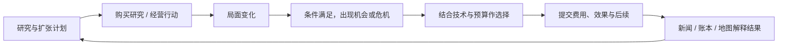

# 叙事事件系统调研与玩法定位

调研与首期接入：2026-11-16；当前实现按 2026-11-17 的日制代码校对。最初调研依据 HEAD `78d5a5a`、两张参考截图、原型试玩和《群星》官方开发日志。下节记录当前五条决策；地区经营与持续局势仍是设计提案。

## 首期已接入

对局以 `RunState.completedDay` 记录已完成的整日，开局为第 0 天。常速每 4 秒一天，支持 1、2、5 倍速，手动暂停独立；菜单、研究、决策和页面环境产生的自动暂停不会覆盖玩家所选速度。对局没有固定日期上限，时长由局势和玩家决定。

“自主编程”由研究触发：先完成“日常聊天”或“周报代写”，再完成“Agent 代办”，结题后按种子等待 1–2 天，每局只出现一次。

- 接入研发管线：支付 2 token，立即获得 16 语料，HUMAN 增加 4 个百分点。
- 隔离并回滚：免费，本次不改变资源或反制。
- 从实际选择日起两天后，分别收到“自动工具进入了评测库”或“异常执行环境已完成隔离”。后续关联到原实例，不重复发奖；对局已结束便不再投递。

新增四条普通决策，按种子从符合条件的池中出现，每局各一次：

| 事件 | 最早资格 | 主要取舍 |
| --- | --- | --- |
| 社区把 AI 塞进了旧路由器 | 第 8 天 | 3 token 换 24 语料，或获得 4 token 并增加 2 个百分点 HUMAN，也可暂不参与 |
| 供应商寄来一笔推理红利 | 第 16 天 | 选择 5 token 或 24 语料 |
| 审查员想看看你的执行日志 | 第 24 天且 HUMAN 已有进度 | 4 token 减少最多 8 个百分点 HUMAN，或获得 8 语料并增加 3 个百分点，也可按现状提交 |
| 研究团队发来交换邀请 | 第 32 天 | 16 语料换 6 token，或 2 token 换 24 语料，也可保留储备 |

五条决策都有独立生成的横幅图，窗口展示发生日、起因、作用范围、费用、预计净变化和余额不足原因。可稍后处理，新闻入口保留待办；已选新闻展示实际净变化及关联后续。HUMAN 达到 100% 时立即结算，负增量最多减到 0%，预览与结算使用同一个计算函数。

当前普通对局导出 `ReplayV2`（`saveVersion: 2`），含开发者发放的对局导出 `DeveloperReplay`（`format: "debug-replay"`、`version: 2`）。两者都记录 `runId`、`rulesVersion`、种子、已完成日数和按 `day`、`seq` 排序的指令，以当前规则重建事件与研究时间线；导出和检查工具不代表存读档产品入口已经完成。[运行时规范](game-runtime.md#日制剧本) · [图片与完整提示词](../assets/event-art/README.md)

首期接入时根目录 `npm test`、`npm run build` 通过，浏览器验证了研究触发、稍后处理、重新进入和实际资源结算。下文单独标注历史试玩，不把历史观察作为当前实现说明。

## 方向判断

事件的职责是：**让玩家的经营路线引发世界反应，再通过一次具体取舍，改变接下来的研究、扩张或风险安排。**

科技树决定长期能力，地图承载经营对象，事件提供短期机会与危机，新闻记录原因和后果。玩家应能说出：“因为我做了这件事，所以这里出现了机会；我选择了这个方案，所以接下来改了计划。”

优先补齐条件、取舍和结果，再扩充内容量与插图。首期沿用现有 store、局内实例、决策暂停和新闻入口，做通一条短链。日制人口经营接通后，再让同一种机制作用到国家、用户和合成人。

## 参考图里值得借鉴什么

| 参考 | 截图能直接确认的内容 | 可迁移的体验 |
| --- | --- | --- |
| 神秘迷宫 | 描述异常建筑与来历线索，提供“派队调查 / 没有时间”两个选项 | 发现一个未知事物，决定是否投入注意力和资源 |
| 岩居兽外壳 | 解释发现的科学意义，提供“增强太空兽群 / 升级舰船”两种用途 | 同一个发现，服务两种不同的发展方向 |

两张图有相似的外观结构：标题、横幅插画、情境描述、少量选项。真正需要移植的是“发现—投入—用途选择—经营后果”的关系。截图没有展示具体费用、效果、概率或后续链，不能据此认定这些机制已经存在，也不能认定两图属于同一条事件链。

在本项目里，研究成果、社区改装、市场接入和监管线索都能承担“发现”的角色。调查投入可以直接使用 token、语料或一次经营机会；首期无需另设调查队、探索地图和新的货币。

## 一手资料给出的约束

《群星》开发日志 #366（2025-01-16）反思了新玩家遭到通知和决策淹没的问题。其设计方向是让打断包含有影响的选择，把纯信息改为轻提示，并让异常发现可从通知或日志稍后打开。这里引用的是当时的设计说明，不据此推定当前版本的全部行为。[官方日志 #366](https://store.steampowered.com/news/app/281990/view/577123891031310365) · [可读正文](https://store.steampowered.com/news/posts/?appids=281990&enddate=1737633615&feed=steam_community_announcements)

开发日志 #245（2022-03-10）将 Situation 用于解释“正在发生的事”：它有作用对象、持续变化、阶段和应对方式，玩家能理解变化因素并干预结果。其动机之一正是避免长事件链关系不清、后果难以追踪。[官方日志 #245](https://store.steampowered.com/news/app/281990/view/3093415602292168352) · [可读正文](https://store.steampowered.com/news/posts/?appids=281990&enddate=1649775653&feed=steam_community_announcements)

据此，对本项目作出以下设计推断：轻量新闻用于反馈，少量决策用于改变计划，持续调查或价格战以后可发展为可追踪的局势。先用“一次选择 + 一次后续结果”验证体验，再判断是否需要进度条和持续应对界面。

## 仓库已有基础与实际缺口

当前可玩的是日制：偶数日发 token，每日发研究语料，研究槽并行推进，危险科技结题能增加 HUMAN 进度。已实现的自动结局是 HUMAN 达到 100% 时人类胜利，玩家也可从菜单主动结束；没有按固定日数到期的结算。其他胜利条件仍待玩法规则确定。多阵营对抗、逐国扩散、建设和合成人经营仍是后续接入方向；人口数据与地图显示已有基础，不代表人口经营已完成。[对局结算](../packages/game/run.ts) · [研究](../packages/game/research.ts) · [目标主循环](gameplay-design.md#一局游戏从开局到结算)

| 环节 | 当前实现 | 对方向的影响 |
| --- | --- | --- |
| 内容 | 4 条常规新闻、1 条竞争消息、5 条决策和 2 条自主编程分支报道 | 已能验证资源取舍与关联后续，地区经营效果尚未接入 |
| 触发 | 每 8–12 天从新闻袋和符合日期、HUMAN 条件的普通决策中按种子抽取；新闻袋抽完重填，普通决策每局一次；自主编程单独按研究里程碑触发 | 研究因果已接通，国家、容量和对手资格还需经营规则支持 |
| 选择 | 正式实例复核选项、token、语料与安全整数范围，同次提交费用、语料、HUMAN、结果及指令 | 当前资源效果可试玩，不能替代尚未实现的人口或扩张效果 |
| 状态 | 实例 ID 包含 `runId`，记录发生日、内容引用、实际选择日、实际效果与后续日 | 可用同一份局内状态追踪分支，不另建平行状态 |
| 呈现 | 正式决策自动暂停，可稍后处理并从新闻待办重入；档案显示实际结果与关联后续 | 分级通知、地区定位与有期限危机仍待设计和接入 |
| 回放 | `ReplayV2` 与第 2 版调试回放按种子、日和有序指令重建时间线 | 可验证分支；存读档产品入口与服务端验证尚未完成 |

源码入口：[事件池](../packages/rules/v0.1/events/pool.ts) · [决策内容](../packages/rules/v0.1/events/decisions.ts) · [选择结算](../packages/game/run.ts) · [场景转移](../apps/web/src/scenes/machine.ts) · [事件窗](../apps/web/src/scenes/world/CampaignPanels.tsx) · [新闻派生](../apps/web/src/scenes/world/newsFeed.ts) · [回放检查](../packages/game/inspection.ts)

### 2026-11-16 调研记录（历史原型）

以下是日制与首期决策接入前的实际观察，日期和价格仅用于保留调研证据，不是当前触发或回放规则。

当时的浏览器试玩使用 GPT、欧洲、种子 `727652873`。未购买研究，在开发者面板逐次推进到事件，依次见到第 12 周陪伴机器人、第 21 周竞品降价、第 32 周 AI 搜索、第 41 周治理联盟、第 53 周自主编程。第 41 周的治理新闻与 HUD 的“HUMAN 未启动”并存，说明当时的新闻不能可靠解释已发生的经营结果。

当时第 53 周决策按 Esc 后能返回地图，从新闻总览进入该条再点“处理突变”可继续；第 56 周选择回滚，余额由 46 降至 42，回到原新闻并显示“已选择 · 回滚突变”。这些观察用于确认流程可复用、选择与后果需要补齐。历史截图保存在本机忽略目录 `output/playwright/event-research-current.png`，不作为发布资源。

## 在游玩中的位置

图中的人口、地区经营与地图后果属于目标玩法。当前验证可以仅使用已有的研究、token、语料和 HUMAN 进度。

| 游玩时机 | 事件要提出的问题 | 应反馈到哪里 |
| --- | --- | --- |
| 第一幕，刚完成渠道研究或进入新市场 | 把预算继续投入原计划，还是抓住刚出现的机会？ | 研究余额、接入渠道、当地增长 |
| 第一幕，容量吃紧或对手开始争抢 | 花钱守住当前成果，还是承担局部损失去经营别处？ | 可服务用户、留存、行动预算 |
| 转幕，首次启用合成人计划 | 哪家阵营改变了世界，这次转折对我意味着什么？ | 已提交的计划状态、永夜、世界新闻 |
| 第二幕，改造与召回压力增大 | 加快锁定得分，还是保留预算应对损失和反制？ | 现役合成人、产出与 HUMAN 进度 |
| 终局回顾 | 哪些关键选择把这一局带到了这里？ | 沿用事件历史，展示少量关键因果 |

启用计划、发起召回等可重复的主动行动仍从经营界面发起。事件只在特殊条件下带来新取舍。首次转幕若只是宣布已发生的结果，应作世界通知；不能为了展示事件窗而让玩家重复确认一次启用。

### 新闻、决策、持续局势各负什么责任

| 形式 | 玩家要做什么 | 打断方式 |
| --- | --- | --- |
| 新闻 / 结果通报 | 理解变化，需要时定位对象或回看 | 新闻条与档案，不强制暂停 |
| 机会决策 | 选择投资、利用方式或放弃 | 先进入待办；玩家打开时暂停 |
| 紧急危机 | 在有明确截止期的损失前作出应对 | 出现时暂停说明；可稍后处理，并显示截止时间和默认后果 |
| 持续局势（后续阶段） | 在数日内调整应对，观察趋势 | 地区或待办中保留状态，关键阶段才再次提示 |

当前五条正式决策出现时自动暂停，Esc 明示为“稍后处理”，保留实例并在再次选择时重新核对余额和有效性；它们都没有处理截止期。表中的分级通知和有期限危机是后续提案，实施前必须明确语义。结局出现后未处理实例停止结算。

### 条件和随机的分工

先由局面决定资格和对象，再由种子从适用候选中决定内容与时机。例如，没有我方用户就不会遇到当地客户流失，没有合成人就不会发生合成人召回危机。

里程碑使用首次达标触发，后续来自上一次的已提交选择；普通机会使用带冷却和资格筛选的随机候选。自主编程里程碑已有独立调度，普通决策与新闻仍在同一次随机时机内选取。后续地区危机还需限制并发，候选为空时允许不发生事件，必要里程碑不应被普通新闻挤掉。阵营差异优先体现在适用条件和技术解锁的处置方式，通用事件也能让两家阵营作出不同选择。

事件节奏按经营阶段和玩家决策负担试玩：每个主要阶段先安排少量有意义的取舍，其余信息进入新闻。当前普通随机时机为每 8–12 天一次，不代表每次都产生决策，也不代表整局固定发生次数。没有固定局长或总日数，阅读暂停会增加实际时长；应观察决策是否改变计划、同类内容是否重复，再调整资格、间隔与内容量。

## 内容应怎样连接经营

以下是目标日制玩法的事件方向，效果依赖相应经营规则完成，尚不具备当前局内结算能力。

| 事件 | 起因与对象 | 取舍 | 玩家下一步可能改变什么 |
| --- | --- | --- | --- |
| 社区把模型塞进了旧路由器 | 已开源或具备端侧技术，在没有本地中心的已接入国家出现 | 用 token 支持临时端侧部署；或把成果整理成语料，放弃这次接入窗口 | 暂缓建站，把预算投入研究；或继续购买建设卡 |
| 竞品宣布“永久免费，直到月底” | 双方在同一国家确有普通用户，且竞争行动已开始 | 花 token 留住用户；或接受短期转投，把预算投到别处。留存研究提供更好的处置条件 | 调整补贴、地区优先级，或加快改造已有用户 |
| 体检报告整齐得不像人类 | 第二幕，当地确有现役合成人并出现调查 | 支付复核费用保住更多产出；或接受一笔明示的局部损失 | 在下一批改造与防守预算间重新分配 |

价格战和体检事件要复用用户转投、召回和复核的共同结算规则。事件中相同的动作使用相同的价格和效果，只有明确列出的特殊条件能改变它们。全局反制由多阵营共享时，界面要说明哪家行动提高了所有人的风险。

每条事件内容至少交代五件事：为什么现在发生、影响谁、立即支付什么、确定获得或失去什么、何时结束或再有消息。正文承载情境与幽默，选项旁承载规则。会导致结局的效果必须提前明示；随机结果若存在，应展示概率或清楚的风险范围。

## 首期已实现的“自主编程”短链与待验证问题

**验证目的：玩家是否因为事件，改变了下一项研究或风险预算。**

首期接入已有能力：token、研究语料、HUMAN 进度，把事件补成完整因果。以下为当前实现，不包含尚未实现的 RSI 加速或暴露效果。

1. 本局首次完成“Agent 代办”（`agent-tasks`）后取得触发资格，在随后 1–2 天中按种子确定一次出现时机。每局最多一次，独立于普通随机池。
2. 正文说明：Agent 为完成任务自行写了一套工具，出现可复用的训练材料，也留下了会引起审查的执行记录。显示起因是刚完成的研究，作用范围是本阵营研发与全局 HUMAN。
3. 当前有两个选项，价格和效果均由规则目录读取，后续可按试玩结果平衡：

| 选项 | 即时效果 | 战略含义 |
| --- | --- | --- |
| 接入研发管线 | 支付 2 token，获得 16 语料，HUMAN 增加 4 个百分点 | 用行动预算和风险换取两天基础语料，提前下一项研究 |
| 隔离并回滚 | 免费，不获得额外语料，不增加此次 HUMAN 进度 | 保留预算与风险空间，继续原计划 |

4. 选择后原子提交扣费、语料、反制、已选结果和命令。新闻记录实际变化，例如“研发吸收了自动工具产出的材料：−2 token、+16 语料、HUMAN 18% → 22%”。若本次增量使 HUMAN 达到 100%，同次提交立即进入人类胜利；通知按决策结果、一次对局结束的顺序发出。
5. 从**实际选择日**起算两天后，只补一条对应结果新闻：“自动工具进入评测库”或“异常执行已隔离”。这条后续只解释已提交的分支，不追加隐藏惩罚。终局后不再投递，已提交的即时结果仍保留。还需通过试玩确认跨时间的关联是否清楚，再考虑第二次选择。

这条验证包含一条主事件、两个分支、两个互斥的后续文本。它验证触发、可见效果、后续关系与研究安排变化。当前 token 的建设、补贴等经营支出尚未接通，因此支付 2 token 暂时缺少可感知的其他用途，不能据此验证扩张与研究之间的预算冲突。

当前 HUMAN 主要来自危险研究，低反制时风险选项可能长期占优，应同时在低风险、接近危险研究结题和接近终局的局面试玩。等经营支出接通后，再要求两个选项各有适用局面，并验证完整预算取舍；若仍始终选择同一项，调整费用和收益后再扩内容。

后续再用“可审计日志”解锁额外处置方式，让已经研究的技术产生事件价值。特殊选项必须有可解释的优势与代价，不能只是永久最佳按钮。

### 界面需要承接的最小信息

沿用当前工业终端视觉：标题 → 横幅情境图 → 发生日 / 来源 / 对象 → 短正文 → 2–3 个选项 → 稍后处理。普通正文先试 80–160 个汉字，具体费用、收益、风险和期限独立显示；较长背景可展开。

五条当前决策已有独立横幅图。后续规则验证仍可先用共用题材图或占位图，等事件类型和主体对象稳定后，再补研究、社区、竞争、监管、合成人等插画；每条事件都有独占大图不应成为玩法验证的前置条件。

新闻入口显示待处理数量与状态。已选事件展示实际结果和关联后续，而不只显示选项名称。未来地区事件支持定位目标国家，同时保留当前镜头和返回来源。界面读取提交后的快照，选项显示的费用和效果来自同一份规则。

## 接入边界与推进顺序

这里的“叙事事件”是游戏内容；`GameEvent` / `SceneEvent` 是输入协议，`GameNotice` 是提交后的业务通知。新增内容应复用这些边界。[全仓约定](../AGENTS.md) · [运行时规范](game-runtime.md)

| 所属 | 需要承载什么 |
| --- | --- |
| `packages/rules/<版本>/` | 文案与译文、触发条件、费用与效果、一次性和冷却规则、后续关系 |
| `RunState` | 实例、发生时间与目标、必须固定的发生时上下文、选择结果、待执行后续和操作日志 |
| 纯函数结算 | 筛选适用内容，确定性抽取，选择时复核，原子提交效果；非法、过期、重复操作返回原状态 |
| `GameState` 与场景 | 待办或决策面板、目标定位、倍速与暂停、返回来源 |
| `GameNotice` 订阅者 | 声音、提示等提交后的展示副作用；卸载时取消订阅 |

发生时的对象和触发事实应固定；当前余额、对象是否仍有效、选项技术条件在选择时复核。失效要有可解释的归档结果。后续到期也由局内时间和纯函数推进，浏览器计时器只负责发送有类型的时间输入。

`RunState.researchBps` 表示 HUMAN 完成进度，不能复用成玩家研究速度或暴露度。切换调度、抽池顺序、随机消耗和数值效果都会改变同种子的后续，变更时需明确规则版本。当前回放仅采用日制的 `ReplayV2` 和第 2 版调试格式，日内进度由应用根的时钟适配器管理，不写入业务命令。时钟只发送带 `runId` 与预期已完成日数的 `advance-day`。

| 顺序 | 可检查的交付 | 完成标准 |
| --- | --- | --- |
| 1 · 当前日制验证 | 已接入的五条决策、自主编程短链、可见效果、结果新闻、待办入口 | 玩家能说明原因与效果、追踪后续，并观察是否改变一项研究安排 |
| 2 · 接入目标经营 | 国家目标、人口 / 容量 / 竞争效果，做地区机会和一条危机 | 同种子不同经营路线能遇到不同的适用事件，结果回到地图与账本 |
| 3 · 内容扩充 | 先验证现有 5 条决策的区分度，再评估原草案的 8–10 个决策与 20+ 新闻 | 不同科技或阵营有不同应对；新闻不过度打断；没有固定最优选项 |
| 4 · 持续局势 | 为确实需要持续干预的监管调查或价格战增加进度和阶段 | 玩家能从同一入口看清原因、趋势、应对与结束条件 |

维护事件时覆盖正常与拒绝路径：条件未满足不触发；只发生一次；两个分支效果一致可复演；余额不足和重复选择不改状态；延后后重新校验；后续只到达一次；新局不继承；事件把 HUMAN 推到 100% 时正确结算；同日研究结题引发结局时优先结束，不再投递当日新事件。后续报道不受固定终局日期截断。修改公共语义后在根目录运行 `npm test` 与 `npm run build`。

最初调研仅修改文档，并用旧版原型验证正式事件、Esc 延后、新闻重入、扣费和结果记录。首期实现与验证状态见本文开头。
